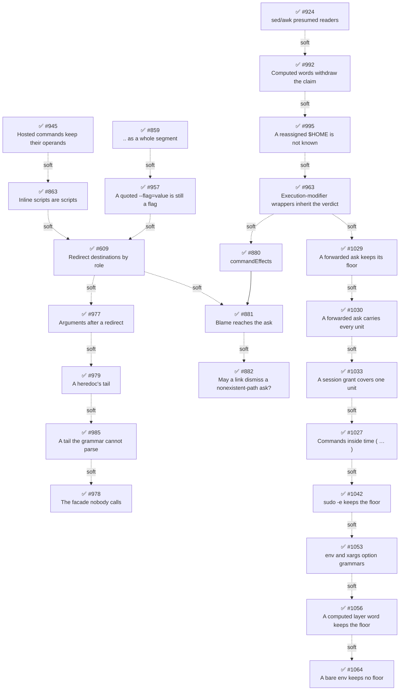

# Phase 15: Token roles and declared effects

## Findings (planned 2026-09-05)

The declared candidate is [ADR-0013](../../decisions/0013-permission-policy-model.md)'s Staging section, whose slices 4–7 Phase 14 assigned to this phase, and its unfiled remainder of slice 2 — the user-declaration half of §7, `commandEffects`, which Phase 14 split off so wrapper transparency could depend on the audited core alone.
That half is described as shipped in `docs/configuration.md` ("A user `commandEffects` declaration participates in effect classification") while no such key exists in `config-schema.ts`; the drift is corrected by [#880].

The cause is that **a bash token's role is established at collection and discarded before projection**.
The collectors know whether a token is a redirect destination, an inline script, a pattern, or an operand — that is how they attribute a `TokenEffect` — but `PathToken` carries only the effect, so `BashPathResolver` re-judges every token by shape and existence as if it were roleless.
Two open defects are that one loss seen from both sides.
A redirect destination arrives at `projectRuleCandidates` tagged `{ effect: "write", source: "syntax" }` and is dropped, because `newfile` is bare and does not exist yet ([#609]'s residual; ADR 0013 measured it as "collection is real; classification then drops the token").
An interpreter's inline script (`node -e "// comment…"`) is projected, because after quote removal the token starts with `/` ([#863]).
ADR 0013 §10 says effects attach per path token, and the collector already tags them there; threading the role the same way is the decide-once fix.
The symptom fallow sees is the `child.type === "command_name" || child.type === "variable_assignment"` disjunction spelled literally at three sites while `COMMAND_PREFIX_TYPES` exists for it — cited as a symptom, and paid down as [#609]'s tidy-first prep (reassigned to [#977] at [#609]'s planning, since none of the three sites is a function [#609] edits).

A second cause surfaced while measuring: **blame never reaches the entries a human decides**.
Each bash gate stamps `effect`/`effectSource` and the flagged paths on its `logContext`, and the runner spreads that context into the entries it writes — but on `ask` the gate writes nothing, and `PermissionPrompter` brackets the ask (`waiting`/`approved`/`denied`) from `PromptPermissionDetails`, a second projection that never sees the context.
The local review log has **zero** entries carrying an `effect` key, and every one of the 134 bash `external_directory` asks since [#807] shipped records `path: null` and no `externalPaths`.
ADR 0013 §7's "provenance is logged" and the package skill's claim that the stamped context makes a retraction readable both describe a path no ask takes; [#881] dissolves it by making the deciding path and its effect provenance **request facts**, which every writer renders.

Measured against the local review log (`scripts/measure-path-false-positives.mjs`, 2026-09-05): of 617 bash `external_directory` asks carrying paths, 28 (4.5%) flagged a token with a shape no path has, and the count is 12 → 6 → 4 → 6 by month with no revision-range ask at all (55 commands carry one, all under a known base).
The other ~95% flag real paths outside the tree, where the question is direction rather than candidacy.
`scripts/measure-core-coverage.mjs` (same date) says `external_directory_read: {"*": "allow"}` would relieve 98 of 388 recent bash asks today, and the remaining head words are led by `git` (92) and `sed` (24) — exactly the subcommand- and option-dependent readers §7's `commandEffects` was written for, though [#924] since claims the read-only share of the `sed` count for the core so that no declaration is needed for it — then wrappers and interpreters (`xargs` 61, `timeout` 30, `env` 22, `pnpm` 20, `bash` 19, `python3` 15), band C, whose only belief-free relief is §8's sandbox tier.

Corroboration (fallow, 2026-09-05): health 78 (B), dead code 0, duplication 1.3% — up from 0.1%, entirely the five `scripts/measure-*.mjs` instruments cloning one review-log-reading prelude (production `src/` still holds the same two small clone groups).
The hotspot list is led by `test/access-intent/bash/program.test.ts` (43 commits), `src/index.ts` (cooling), the two gate fixtures, and `token-collection.ts` / `command-enumeration.ts` (accelerating) — the files this phase's spine rewrites.
The repeated-discriminator sweep found one new family, the `COMMAND_PREFIX_TYPES` clone above; the rest are validation-edge `typeof` guards and per-node AST dispatch, idiomatic.

The craftsmanship scout **refuted all six** fallow large-function flags on test files (each a nested tree of behavior-named `it`s with `it.each` collapsing near-duplicates) and refuted the planner's first reading that the generic and pattern-first token walkers, or `readCommandWords` and `commandArgumentWords`, are one state machine spelled twice — their filters and outputs differ.
It found one concentrated test-design cluster: `test/handlers/gates/bash-path-extractor.test.ts` re-tests ~300 lines of `BashProgram` coverage through the facade (`/etc/[p]asswd`, the `for` word list, `$(cat /etc/hosts)`, redirect targets), so [#821] and [#839] each landed in two files.
That rides [#609] as a `test:` prep commit — [#609] would otherwise land in both files a third time.
[#609]'s planning found the facade has no production caller, so [#609] adds no case there; the cluster is [#978].
`collectPatternCommandTokens` (cognitive 45) is adjudicated a justified state machine, `runDescriptor` stays whole (Phase 14's call holds), and `src/index.ts` is unchanged since Phase 14's clearance.
The `scripts/` prelude duplication is scattered and rides whichever step next adds an instrument.

Directory check: skipped — `src/` holds five root files and every module this phase touches has a home in the directory vocabulary; [#924] and [#880] both land in `access-intent/bash/`, where effect classification already sits.

Trajectory: Phase 12's maximum step priority was 20, Phase 13's 20, Phase 14's 20; this phase's is 20 ([#880]).
No decline, so the regular improvement rotation continues.

The operator's clarification shaped the composition: the friction that matters is the **false positive** — a token that is not a path at all — not the ask about a real external file.
After [#863] and [#859] close the cases syntax or a known table decides, what remains is the shape-indistinguishable class ([#797]'s `/Sheet1/B1`, which no rule separates from `/etc/passwd`), and it has two complementary levers on opposite sides of `evaluate()`: a declaration that withdraws a *named* tool's operands ([#880]'s `effects: []`, the ask-producing side, zero tokens, permanent) and judgment that dismisses an ask for a token naming nothing on disk ([#882], the ask-consuming side, for the tool nobody declared).
That is ADR 0013 §7's own core-versus-chain layering applied to candidacy, and neither lever makes the other redundant.
[#882] exists because ADR 0007 §5 and ADR 0013 §7 contradict each other on this population — §7 says the judge absorbs the surplus, §5 excludes `external_directory` from a link's `allow`, so the judge can only defer it back to the human ([#859]'s reporter noticed; [#684] presses for a blanket opt-out this phase does not adopt).

Deferred by composition, with the reason each carries: [#804] (staging slice 7, structured bash rules) is the largest slice and depends on [#880]'s config shape as its precedent, so it waits for Phase 17 with that shape settled, Phase 16 having been given to the sandbox record ([#892]) whole; [#799] (channels) and [#780] compete with [#882] for one ADR budget, and [#882] won it because it is the one the false-positive population needs.

### Open-issue sweep dispositions

- [#609] — adopted as a step (staging slice 4), carrying the phase's breaking change.
- [#863] and [#859] — adopted as steps (2nd consecutive sweep, scheduled).
  [#863] was closed `NOT_PLANNED` on 2026-09-07 against the sandbox-first re-sequencing and reopened on 2026-09-18 when that re-sequencing was revised; its committed plan stands as written.
  Both are shape decisions the classifier makes on tokens whose role the collector already knew, and each fix is fail-closed: a script string was never a path, and the [#645] existence probe still admits a real file named `a..b`.
- [#802] — **moved whole to Phase 16** (operator decision, 2026-09-18), where it joins [#892].
  It was adopted here as a step (staging slice 6, first two of its three parts), then scoped up by [#892] and finally moved out with it.
  Two reasons: the step publishes `PolicyScope` / `ScopeGrant` / `getPolicyScope` in `dist/public.d.ts`, and a public surface shipped before the record that decides the manifest shape is a surface the record may have to break; and its own recorded design question — how a rule pattern becomes a root, and what happens to a pattern naming no directory — is the manifest compiler's question, which should be answered once rather than twice.
- [#945] — filed by this session, split out of [#863]'s committed plan; adopted as the phase's first step, ahead of [#863].
  A command hosted in a consumed flag argument has its operands dropped, which ADR 0009 names a positional-invariance **guarantee** rather than a residual.
  Its planning session measured the same loss in three further argument positions and the operator widened the step to the class; the step above records what landed.
  It is a separate step rather than [#863]'s prep commit because the two failure directions are opposite — this one is an under-reach that drops a real operand, the unrecoverable direction, where [#863] is an over-reach that invents one — and it stands on its own merits under every future the roadmap is weighing.
- [#924] — adopted as a step, ahead of [#880].
  `sed` and `awk` are excluded from the pure-reader core outright, so `sed -n '1,80p' file` consults `external_directory_write` for a read — `sed` is 24 of the 388 recent asks this phase's findings already measure.
  It is the core side of the same boundary [#880] approaches from the declaration side, and it needs no configuration from the user to deliver relief, so it lands first and shrinks the population the declared layer must cover.
  Both edit `command-effects.ts`, so they sequence rather than parallelize.
- [#957] — filed by [#863]'s planning; adopted as a new step, after [#859] and ahead of [#609].
  A quoted `--flag='value'` on any pattern-first command bypasses the flag table, so `grep --regexp='/etc/passwd' f.txt` raises an `external_directory` ask for a file `grep` never opens.
  Measured population over 7937 corpus commands is 0 real invocations, so it makes no claim on the phase's relief budget; it is adopted anyway because it is the same over-surface family as [#863] and [#859], it lands in the same file and the same walker, and leaving it open would have [#609] rewire that walker's roles around a known gap.
  Adopted knowing ADR 0009 already declined the wider form of this fix: the step's substance is the amendment that admits the narrower one, not the ten lines of code.
- [#880] — filed for the `commandEffects` step; the unfiled remainder of staging slice 2 (ADR 0013 §7).
- [#881] — filed for the blame-threading step (staging slice 5), recast from a UX slice into a `fix:` by the measurement above.
- [#800] — **close as completed** with the config recipe: `external_directory_read: {"*": "allow"}` plus the pure-reader core delivers what it asks for `cat`/`ls`/`find`/`grep`, and [#880] covers the non-core readers it names (`strings`, `file`) by declaration.
- [#804] — deferred to **Phase 17** with recorded rationale (operator composition decision; 3rd consecutive sweep): it mirrors the `commandEffects` shape [#880] creates, and landing it in the same phase would have both steps deciding one shape.
  It was deferred to Phase 16 by the previous two sweeps; Phase 16 is now the sandbox record's alone, so the same rationale moves it one phase further rather than changing.
- [#822] — deferred to Phase 16 with recorded rationale (operator decision; 3rd consecutive sweep): a sandbox subsumes static glob expansion, so the mechanism waits for the seam that would replace it — which is now Phase 16's subject rather than a step of this phase.
- [#952] — filed by this session; deferred to **Phase 17**, beside [#804].
  An extension or MCP tool cannot declare its direction, so `effectProvenByTool` returns `unproven`, the gate names the bare `external_directory` family, and the write surface's catch-all vetoes a read a directional grant already allowed — measured on `read_session_file`, where all 5 schema-carrying prompts in the local review log record `matchedPattern: "*"` against `external_directory_write`.
  Its `toolEffects` key mirrors the config shape [#880] creates, which is the rationale [#804] and [#926] already carry: two steps deciding one config shape in one phase is the outcome to avoid.
- [#926] — deferred with recorded rationale (operator decision): transparent wrapper commands (`rtk ls` needing rules separately from `ls`) want a user-declared alias table, which mirrors the config shape [#880] creates.
  This is the same rationale [#804] carries, and it applies for the same reason: two steps deciding one config shape in one phase is the outcome to avoid.
- [#931] — out of scope for the roadmap.
  Automatic rejection when a prompt's delay is exceeded is prompt-lifecycle behavior in the presentation seam Phase 13 opened, not this phase's role loss; it also composes with [#799]'s channels, which this phase deferred.
- [#936] — out of scope for the roadmap.
  The Pi Session Inspector maintainer asks this package to confirm that `permissions:ready` / `permissions:ui_prompt` / `permissions:decision` remain a supported cross-extension contract; it wants an answer on the issue, not a step.
- [#906] — out of scope for the roadmap.
  A terminal attention signal (BEL/OSC) when a prompt opens is a presentation-layer addition sharing no step's mechanism; small and self-contained, so a cheap independent candidate for any phase.
- [#946] — filed by [#928]'s planning, which carries gap 1 alone; out of scope for the roadmap.
  Routing a registered MCP proxy tool name to the `mcp` surface edits `classifyToolKind` and adds a cross-extension registry, sharing no mechanism with this phase's bash token-role loss.
  PR [#930] is its reference implementation, and its registration API is a public surface to weigh on its own.
- [#620] — deferred with recorded rationale (explicit operator decision; **4th consecutive sweep**, not a silent re-defer).
  [#880] narrows its charter again — a declared `git log` needs no judge — and Phase 16's sandbox record answers band C without belief, so what remains for the chain is genuinely judgment; it is re-evaluated once both have landed.
  [#698] and [#706] fold into it when it is scheduled.
- [#751] — deferred with recorded rationale (explicit operator decision; 3rd consecutive sweep): still small, self-contained, and the last ADR 0011 §4 residual; a cheap independent candidate for any phase.
- [#519] — deferred with recorded rationale (explicit operator decision): externally blocked on Pi SDK `UIContext` evolution, with no in-repo lever.
- [#799] — deferred with recorded rationale (operator composition decision; 2nd consecutive sweep): the strongest non-code candidate, blocking PRs [#675], [#692], and [#638]; [#671]'s launcher env contract and [#720]'s `--yolo` flag are channels too and join its inventory.
- [#780] — deferred with recorded rationale (2nd consecutive sweep): the outbound-bridge ADR is what PR [#693] waits on; it joins [#799] in the next ADR budget.
- [#861], [#868], [#875] — deferred with recorded rationale (2nd consecutive sweep each): the same dispositions as Phase 14's, unchanged by this phase's cause — [#861] is the ADR 0007 §5 deliberation's neighbor, [#868] reopens `config-schema.ts` and may ride [#880]'s schema edit as a boy-scout tidy, and [#875] is an enumeration residual with no verdict-fold lever.
  [#861] and [#875] were then pulled forward by operator decision and shipped outside this phase, as [#899] was.
  The 2026-09-15 triage ranked [#861] 3 in Band 1, promoting it over this second deferral: an operator names a chain link, does not get it, and learns so only from the review log — measured at 48 silent skips across 13 days in one log.
  The deferral's reading held and was beside the point: the issue *is* the ADR 0007 §5 deliberation's neighbor, and it needed none of that deliberation, because the resolution was never in question and only its silence was.
  The deferral rested on a reading that did not hold: "no verdict-fold lever" was correct and irrelevant, because the lever is one layer up, in enumeration.
  The 2026-09-15 triage ranked it 2 in Band 1 after reading it end to end — a configured `deny` silently not firing on a script `bash -n` accepts is a bypass — and planning then measured the wider half the issue does not state: the dropped region's **path** operands reached neither `path` nor `external_directory` either, an ADR 0009 completeness-contract violation.
  The remedy is a fourth direction neither the issue nor ADR 0013's amendment listed, recorded in both records.
- [#874] — out of scope for the roadmap; PR [#757] moves the settings dialog off the overlay path and is its candidate close target.
- [#688] ↔ PR [#703], [#658] ↔ PR [#693], [#736] ↔ PR [#749], [#686] ↔ [#802] (now Phase 16) — each open PR is recorded against the issue it serves; none is merged, per the repo's reimplement-through-TDD practice.
- [#797] — adopted as [#880]'s named acceptance case (`commandEffects: { officecli: { effects: [] } }` produces no ask) and as the example population of [#882]; Phase 14's config-recipe answer (`external_directory: {"/Sheet1/*": "allow"}`) stands as the interim workaround.
- [#882] — filed for the ADR 0007 §5 deliberation step; PR [#684] is its close target either way.
- [#886] — filed by [#863]'s planning; deferred to a later phase.
  It is real roadmap work, but it is not this phase's cause: the phase is about a lost role producing false positives, and [#886] adds prompts in the opposite direction — 270 of 5918 corpus commands carry an interpreter inline script.
  [#880]'s `commandEffects` deliberately does not lift the wrapper floor (ADR 0013 §11) and Phase 16's sandbox record answers band C without belief, so both change its calculus before it is worth scheduling.
- [#892] — filed by [#863]'s planning; **deferred to Phase 16, which it opens** (operator decision, 2026-09-18), taking [#802] with it.
  It was briefly folded into [#802]'s step and moved ahead of every other step, on the reading that a sandbox demotes the projection to a hint and so every projection fix should wait for the record.
  That was revised for three reasons.
  The scope the fold produced — decision record, manifest compiler, `bash` tool override, a Linux seccomp-notify backend, a macOS backend, and a fallback prompt — is a phase's worth of work wearing a step's number.
  The blocking was wider than the finding supported: [#880], [#881], and [#882] are the decision layer, which the review itself called "the product", and no sandbox delivers `commandEffects`, blame on an ask, or the ADR 0007 §5 answer.
  And the two upstream reports the review filed are both still open, including [nono#1797](https://github.com/nolabs-ai/nono/issues/1797), where capability elevation never traps `O_CREAT` or `mkdir` — so the enforcement backend cannot yet see file creation.
  The review's measurements stand and are recorded in [#863]'s retro; what changed is the sequencing built on them.
- [#891] — filed by [#863]'s planning; deferred to Phase 16, behind [#892]'s record.
  Pi's built-in `powershell` tool (v0.84.3, recommended on Windows) reaches only the `tools:` surface today.
  The issue asks for a Codex-shaped static layer — a small literal subset lowered to argv, fail closed on the rest, and deliberately **no** path projection — which is a new shell surface rather than this phase's role-loss cause, and it is sequenced behind the sandbox re-planning Phase 16 opens.
- [#735] scenario 2 / [#722], [#762], [#860], [#856] — unchanged from Phase 14.
- [#890] — filed by the `pi-subagents` [#884] PR review; resolved outside this phase as `pi-subagents` Phase 22 Step 18, whose cross-package plan is [`docs/plans/0890-inherited-region-tool-surface-relocation.md`](https://github.com/gotgenes/pi-packages/blob/main/docs/plans/0890-inherited-region-tool-surface-relocation.md).
  `AgentPrepHandler`'s in-place rewrite of the child's `Available tools:` list landed inside the region `pi-subagents` keeps byte-identical with the parent's, collapsing the shared prefix for any child with a narrowed tool set.
  It is this package's `exposure/` pass, which no step in this phase opens — the spine is token roles and declared effects — so it stayed out of the phase; the tool surface is now relocated to the end of the prompt rather than edited in place ([ADR 0014](../../decisions/0014-tool-surface-is-node-local-prose.md)).
- [#899] — filed by the `pi-subagents` [#889] implementation; deferred to a later phase, then pulled forward and shipped outside this phase.
  An `ask` on an earlier gate suspends the call before a later gate's unconditional `deny` is consulted, so an operator is prompted to approve a command policy already forbids and both answers end in denial — measured as a full 600 s subagent stall on a `bash` rule that resolved correctly when tested directly.
  The deferral rested on a coupling that did not hold: it predicted the fix would hoist resolution ahead of the prompt in `GateRunner.runDescriptor`, pairing it with the `runDescriptor` split this phase's `#### Deferred tidyings swept` list holds as deferred.
  Planning measured that every gate already carries its resolved state on the descriptor (`preCheck` on five, `preResolved` on the skill-read gate), so the fix is a deny-first ordering pass in `ToolCallGatePipeline.evaluate` and the runner is untouched; the `runDescriptor` split stays deferred.
  The cause remains the pipeline's run loop rather than this phase's role loss or its blame gap.
- [#907] — out of scope for the roadmap; PR [#911] is its close target.
  A root interactive session stops serving forwarded permission requests because `ForwardingManager` reads the root's own inherited `PI_SUBAGENT_PARENT_SESSION` marker as subagent evidence — an `authority/` forwarding-lifecycle defect, not this phase's role loss.
- [#909] — out of scope for the roadmap; a third-party request from the Pi Herdsman maintainer, landed as a breaking `feat!:`.
- [#962] — filed by the `pi-subagents` PR [#959] review; out of scope for the roadmap, on [#890]'s precedent. pi 0.86 replaced the `Current working directory:` footer and the `Available tools:` / `Guidelines:` headers with `<cwd>`, `<tools>`, and `<rules>` sections, so `renderToolSurface` finds none of its three anchors and appends the narrowed block below Pi's unfiltered list instead of replacing it.
  It is the same `exposure/` pass [#890] rewrote, which no step in this phase opens — the spine is token roles and declared effects — and the remedy is a prompt-shape question ([ADR 0014](../../decisions/0014-tool-surface-is-node-local-prose.md)'s relocation under named sections), not a role-loss one.
  A subprocess child kept visible in its own pane adjudicated locally because `selectAuthorizer` tested `hasUI` before subagent detection — an `authority/` authority-selection dispatch, not this phase's role loss.
- [#914] — filed by [#907]'s planning; out of scope for the roadmap.
  A Windows atomic-rename failure in `forwarding-io.ts`'s shared write helper drops heartbeat and forwarded-file writes; it is platform robustness in the same layer as [#907], sharing no step's mechanism.
- [#915] — filed by [#899]'s planning; deferred to a later phase with rationale.
  Two gates that each resolve to `ask` on one tool call raise one prompt each — measured as two `escalate` calls for `cat /etc/hosts` under `external_directory: {"*": "ask"}` plus `bash: {"*": "ask"}`.
  Coalescing them needs an ADR 0011 §2 payload that composes several gates' evidence and a `SessionApproval` recording a grant per asking surface, which is the prompt-presentation seam Phase 13 opened rather than this phase's role loss.
  [#881] enriches the fields one ask carries; [#915] changes how many asks there are, so no step produces or consumes what it needs.
- [#923] — filed by [#920]'s planning; out of scope for the roadmap.
  A secret inside an inline-shell payload (`bash -c '…'`) or a heredoc body escapes the grammar-anchored command redaction [#920] adds, so one review-log record can hold the same secret masked under `executedUnit` and unmasked under `command`.
  It reads `classifyWrapperWords` and `EXECUTION_HOST_TYPES` but changes nothing about token roles or declared effects — it is a `logging/` exposure residual, and no step in this phase produces or consumes what it needs.
- [#925] — filed by [#920]'s implementation; out of scope for the roadmap.
  `composition-root.test.ts`'s forwarding-liveness test waits out the ~2 s serving grace window with real timers and flakes against Vitest's default 5 s budget when the root run puts every package in parallel; it was reproduced at the pre-implementation baseline, so it predates that work.
  Test-budget maintenance in an `authority/` integration test, which no step in this phase opens.
- [#933] — filed by [#927]'s implementation; out of scope for the roadmap.
  `index.ts` primes the store with `configStore.refresh(undefined, false)`, which records `lastConfigWarning` while `ctx?.ui.notify(…)` is a no-op, so the identical warning at `session_start` is deduped away — every issue `loadAndMergeConfigs` produces reaches the debug log and never the user.
  Its nearest neighbor is [#881], but that threads gate provenance into the ask payload where this is a store-level dedupe against a ctx that did not exist yet; it is a `config/` notification-lifecycle defect sharing no step's mechanism.
- [#941] — filed by the repo-level [#938] planning; out of scope for the roadmap.
  A heredoc absorbs the operand preceding it, so `git commit -F - <<'EOF'` enumerates as the unit `git commit -F` — an enumeration fact nothing asserts, which this repo's own project-scope permission config now depends on.
  It is a test-only regression pin over `command-enumeration.ts`'s output, not the role a collector attaches to a token, so no step in this phase produces or consumes what it needs; it is a boy-scout candidate for whichever step next edits `program.test.ts`.
- [#942] — filed by [#937]'s planning; out of scope for the roadmap.
  It applies the 18 `package-pi-permission-system` `offload` rows from the 2026-09-17 agent-doc audit — skill prose relocated into this architecture doc, ADRs, and `docs/subagent-integration.md` — and touches no `src/`, so it is doc restructuring beside the phase rather than roadmap work.
- [#951] — filed by [#923]'s planning; out of scope for the roadmap.
  `redirectMayWriteFile` proves a write for a `/dev/null` destination, so appending `2>/dev/null` to a read-only pipeline withholds [#803]'s `core-reader` exemption and floors the unit to `ask` — measured against every `<indirection-bash-wrapper>` prompt in the local review log since 2026-09-16, all of them proven core readers.
  The cause is a missing device row in `redirect-analysis.ts`'s effect proof, not the phase's role loss at projection; the two touch different modules and different seams.
  One interaction was carried forward from here: that [#609] would newly project `> /dev/null` onto `path_write`.
  [#609]'s planning measured that it already does, since `/dev/null` is absolute and passes the shape gate today, so [#609] changes nothing for it.
- [#953] — filed by [#933]'s planning; out of scope for the roadmap.
  A policy-file issue is warned only at `session_start`, unlatched, while policy is re-read from file mtimes on any turn — so a policy file broken mid-session is rejected fail-closed and the operator is told nothing.
  It is the sibling accumulation to [#933]'s, left out of that fix to keep it tight; the same `config/`–`handlers/` notification-lifecycle class, sharing no step's mechanism.
- [#955] — filed by this session; out of scope for the roadmap.
  `computeExtensionPaths` puts bare `agentDir` in `piInfrastructureDirs`, so `auth.json`, `mcp-oauth/`, and `trust.json` are auto-allowed reads, and the bypass returns from `describeExternalDirectoryGate` ahead of policy resolution, so an explicit `external_directory_read` `deny` on those paths never fires.
  The cause is the breadth of a `config/` path list and the ordering of a `handlers/gates/` short-circuit, not a token role lost at projection; no step in this phase produces or consumes what it needs.
  Small and self-contained, so a cheap independent candidate for any phase.
- [#956] — filed by this session; deferred to a later phase, behind [#955].
  The infrastructure read bypass gates on `READ_ONLY_PATH_BEARING_TOOLS`, a tool-name stand-in for "this access is a read" that predates the direction proof, so `read ~/.pi/agent/npm/…` is auto-allowed while `bash: ls` on the same directory prompts.
  It is real roadmap work — the fix consumes the `TokenEffect` this phase's spine is about — but it is a *consumer* of that proof rather than part of the role loss, which is the same posture [#952] carries.
  It is also blocked: widening the bypass to `bash` widens the `deny` override in [#955] to a surface that can compose a read into a pipeline.
  Distinct from [#800], which asked for read-only relief across *any* external directory and closed on the `external_directory_read` rule; this is the narrower case where the package has already declared the path needs no prompt and only one surface honors it.
- [#963] — filed by an operator session (2026-09-20); **becomes a new step in this phase, after [#924]** (operator decision).
  A wrapper that only changes *how* the same visible command runs (`time`, `timeout`, `nice`, `stdbuf`, `setsid`) is floored with the wrappers that change *what* runs, so `time pnpm run lint` asks where `pnpm run lint` resolves by its own rules — a deterministic false-positive ask in the phase's direction, though its mechanism is ADR 0013 §11's floor rather than a lost token role.
  It owns `wrapper-analysis.ts`, which no other step touches, and it sequences before [#880] so that step's "does not lift the floor" constraint is written against the amended §11.
- [#968] — filed by [#859]'s planning; deferred to a later phase, beside [#822].
  Bash brace expansion (`cat {..,y}/z` reads `../z`) is invisible to the projection, which resolves the literal token as one in-cwd segment; [#859]'s whole-segment rule removes the incidental unknown-base catch the substring test gave it.
  It is a missed operand, the opposite direction to this phase's false-positive cause, and it shares [#822]'s mechanism class of gating a token by what the shell expands it into.
- [#970] — filed by [#962]'s planning; out of scope for the roadmap.
  Raising the `pi-coding-agent` peer floor and devDependency pin past 0.86 is dependency upkeep that lets the footer-shaped prompt layout [#962] keeps be deleted; it is sequenced after [#962] and touches no token role or declared effect.
- [#973] — filed by the [#962] retrospective; out of scope for the roadmap.
  A test-running tool for TDD cycles is repo-wide tooling (`scope:repo`) that touches no token role or declared effect.
- [#976] — filed by [#957]'s PR review (PR #972); out of scope for the roadmap.
  It asks only for a clearer prompt reason on a parse-failure floor, which can land at any time; the parse failure involves no token role, and folding it into [#881] would make it wait on [#880].
- [#977] — filed by [#609]'s planning; **becomes a new step in this phase, directly after [#609]** (operator decision, 2026-09-24).
  `tree-sitter-bash` 0.25.1 parses every word after a redirect as another destination of it, so `git 2>/dev/null push --force` enumerates as the unit `git` and runs under a `git push *` deny, and `find ~/x 2>/dev/null -delete` proves `~/x` a read because the `-delete` guard never sees the flag — both measured through the real `resolveBashCommandCheck`.
  It is this phase's cause one layer down (the parse hands a command's argument the role of a redirect target), and [#609] lands the helper naming a redirect's real target, which this step reuses rather than re-derives.
  It also takes the `COMMAND_PREFIX_TYPES` tidy [#609] was assigned, since it edits `commandArgumentWords`, one of the three re-spelling sites.
- [#978] — filed by [#609]'s planning; **becomes a new step in this phase, after [#977]** (operator decision, 2026-09-24).
  The `bash-path-extractor.test.ts` dedup was [#609]'s assigned prep, but the facade it tests has no production caller, so [#609] adds no case there and the dedup prepared nothing; retiring or narrowing the facade keeps the test-design cluster this phase adopted.
- [#979] — filed by [#977]'s planning; **becomes a new step in this phase, directly after [#977]** (operator decision, 2026-09-25).
  A `heredoc_redirect` hosts the rest of its command line (a `| …`/`&& …` statement, argument words, further redirects), and the walkers read it only for substitutions, so `cat <<EOF | rm -rf /tmp/x` enumerates as `cat` and `cat <<EOF > /tmp/o` projects no path — measured through the real `resolveBashCommandCheck`.
  It is [#977]'s cause in a second grammar production, and it extends the parser-boundary correction [#977] lands rather than adding a walker branch.
- [#985] — filed by [#979]'s planning; **becomes a new step in this phase, directly after [#979]** (operator decision, 2026-09-27).
  A heredoc tail the grammar cannot parse (`cat <<EOF ; rm -rf x`, `&`, words plus a redirect, a descriptor-prefixed `0<<`) is valid bash (`bash -n` exits 0), but the statement errs, so its units floor to `ask` and a `rm *` deny on the command after the heredoc never fires, measured through the real `resolveBashCommandCheck`.
  It is [#979]'s cause where the grammar gives up instead of mis-hanging, and a recovered tree would pass through [#979]'s correction like any other.
- [#986] — filed by [#979]'s planning; out of scope for the roadmap.
  It turns the parse-failure floor into a refusal to the agent when `bash -n` also rejects the command, a UX feature beside [#976].
- [#992] — filed by [#924]'s planning; **becomes a new step in this phase, directly after [#924]** (operator decision).
  A computed argument can spell a `find`/`fd`/`sort` withdrawing option the literal-text guard never sees (`A=-delete; find ~/other $A` resolves on `_read` alone), the same class [#924] closes for `sed` and `awk` by retracting on any computed word.
  It consumes the `ArgWord.computed` fact [#924] threads into `proveCommandEffect`, and it is its own step because it newly prompts on `find . -name "$pat"`, where [#924] regresses nothing.
- [#995] — filed by [#992]'s planning; **becomes a new step in this phase, directly after [#992]** (operator decision, 2026-09-29).
  A plain `$HOME`/`$PWD` resolves to its startup value even after the program reassigns it, so `HOME=-delete; find "$HOME"` projects a core read of the home directory, measured through `BashProgram.parse`.
  It is [#992]'s class (a word only the shell decides, read as known) in the variable vocabulary rather than the guards, and [#992]'s rule inherits the fix through `ArgWord.computed`.
- [#996] — filed by the #906 ship session; out of scope for the roadmap.
  It changes the text of [#906]'s prompt notifications (the session name, tool, and agent), a presentation addition sharing no mechanism with this phase's bash token-role work.
- [#1001] — filed by the Pi 0.99.2 upstream-impact assessment; out of scope for the roadmap.
  Pi's native `mcp__<server>__<tool>` tools reach only the generic extension surface, the same MCP-routing class as [#946], and touch no token role or declared effect.
- [#1002] — filed by the Pi 0.99.2 upstream-impact assessment; out of scope for the roadmap.
  A fully denied direct MCP tool stays declared for the first prompt because `builtin:mcp` registers it after the exposure pass; the gate still denies it, and nothing in it touches this phase's bash token-role work.
- [#1014] — filed by [#1001]'s planning; deferred to a later phase.
  It is the MCP permission model itself (one call identity, Pi's built-in MCP first, the proxy as a registered reader) and the leading candidate for the phase after this one, gathering [#946], [#952]'s MCP half, [#1002], and [#1001]'s residuals; none of it shares this phase's bash token-role spine.
- [#1016] — filed by [#997]'s planning; out of scope for the roadmap.
  A case- or Unicode-normalization variant the filesystem opens as the same file misses a `path` deny on every surface, a canonicalization defect that shares no mechanism with this phase's bash token-role work.
- [#1018] — filed by [#955]'s planning; out of scope for the roadmap.
  The infrastructure read list is compared un-canonicalized against a canonical boundary value, so a symlinked `agentDir` loses the bypass (fails closed); a path-canonicalization defect sharing no token-role or effect mechanism with this phase.
- [#1019] — filed by [#981]'s planning; out of scope for the roadmap.
  A forwarded bash ask carries only the typed command, so the serving node misses the home spelling the child resolved with; the fix is a serving-wire and result-shape change sharing no mechanism with this phase's token roles.
- [#1020] — filed by [#981]'s planning; out of scope for the roadmap.
  A home-prefixed bash pattern is compiled through `path.join`, which rewrites its arguments and its win32 separators; a pattern-compile fix in `wildcard-matcher.ts` / `expand-home.ts`, which no step of this phase touches.
- [#1028] — filed by [#953]'s planning; out of scope for the roadmap.
  Each `config.json` is parsed and validated twice — by `ConfigStore` for the extension settings and by `FilePolicyLoader` for the `permission` block — on different refresh cadences; unifying the reads is a `config/` loader restructuring, not a token role lost at projection.
- [#1027] — filed by [#963]'s planning; **becomes a new step in this phase, directly after [#963]** (operator decision, 2026-10-05).
  `tree-sitter-bash` has no `time` keyword, so `time ( … )` parses as a command whose argument is a subshell, and the commands inside are never enumerated as units; [#963]'s literal-head guard keeps the floor on that shape, which forfeits 10 of the 84 modifier-led floored asks in the local review log.
  Placed after [#963] rather than after [#880] so it releases independently instead of splitting the "declared-effects" batch.
- [#1029] — filed by the #963 retrospective; **becomes a new step in this phase, directly after [#963] and ahead of [#1027]** (operator decision, 2026-10-05).
  A subagent's floored bash ask forwards only its command value, and the serving node resolves that value against plain rules, so a `bash: *` allow auto-approves the ask the wrapper floor raised; it was observed letting a reviewer subagent's `time find . -delete` run unprompted.
  It shares no mechanism with this phase's token roles (it is the forwarding wire [#1019] also touches), but it is a live bypass of a floor this phase keeps relying on, so it lands before the remaining relief steps.
- [#1030] — filed by [#1029]'s planning; **becomes a new step in this phase, directly after [#1029]** (operator decision, 2026-10-05).
  A forwarded bash ask carries only the chain's winning unit, so the serving node approves a whole multi-command line after judging one command (`ls && rm -rf /tmp/x` under a parent `ls*: allow`); [#1029] closes the floored variant of it, and this step closes the plain-rule one.
- [#1031] — filed by [#1029]'s planning; out of scope for the roadmap.
  Setting yolo per node (a child separately from its parent) is a feature, and nothing in this phase's token-role spine touches `yoloMode`.
- [#1033] — filed by [#1030]'s planning; **becomes a new step in this phase, directly after [#1030]** (operator decision, 2026-10-06).
  A session-granted wrapper unit floors to an `ask` that keeps `source: "session"`, wins `pickMostRestrictive`'s first-wins tie, and takes `GateRunner`'s session fast path, so `sudo rm y && git push origin main` runs the `git push *: ask` unit unprompted; it is a live chain bypass in the same `resolveBashCommandCheck` as [#1029] and [#1030].
- [#910] — reopened by its planning (filed and self-closed by its third-party author); out of scope for the roadmap.
  A path argument's absolute spelling joins the bash command unit's spellings on [#981]'s seam, a change to which texts the `bash` surface matches rather than a token role lost at projection; it edits `token-collection.ts` and `command-enumeration.ts`, so it lands before or after [#1027] and [#880], never beside them.
- [#1036] — filed by the #910 retrospective; out of scope for the roadmap.
  It repairs repo-wide markdown that `rumdl`'s MD018 fix turned into headings, unrelated to token roles or declared effects.
- [#1037] — filed by the #910 retrospective; out of scope for the roadmap.
  It lifts the repo's `rumdl` version pin, which is lint tooling, not this package's code.
- [#1042] — filed by [#1039]'s implementation; **becomes a new step in this phase, directly after [#1027]** (operator decision, 2026-10-08).
  `sudo -e`/`--edit` (sudoedit) edits its operands as files, but the wrapper peel skips `-e` as a flag and reads the next word as the inner command, so `sudo -e cat` earns the `core-reader` exemption for a root write; it is a fail-open in the `wrapper-analysis.ts` peel [#963] and [#1027] reshape.
- [#1043] — filed by [#1027]'s planning; deferred to a later phase (operator decision, 2026-10-08).
  It is [#1027]'s residual: `time { …; }`, `time -p ( … )`, and the other `time` shapes the grammar misreads stay floored, so they fail closed.
  The local review log holds no ask for any of them (measured: 0 `time {` asks in 23,641 lines), and recovering them needs a new span re-parse mechanism outside this phase's token-role budget.
- [#1053] — filed by [#1042]'s planning; **becomes a new step in this phase, directly after [#1042]** (operator decision, 2026-10-09).
  `env` and `xargs` option tables misplace the wrapped command (`env -P cat rm x`, `xargs -J cat rm x` earn `core-reader`), and `env -C /etc cat shadow` earns it with a moved cwd; it is [#1042]'s fail-open class on the other wrappers, landing on [#1042]'s grammar dispatch.
- [#1056] — filed by [#1042]'s implementation; **becomes a new step in this phase, directly after [#1053]** (operator decision, 2026-10-09, given with reluctance to grow a phase that should close soon for the sandbox phase).
  An unquoted computed word in a peeled layer's options or values (`sudo -u $U cat x`, `timeout $D cat x`) splits into the command that runs while `core-reader` judges `cat`; the execution-modifier clause already refuses a non-literal layer, and the core-reader clause lacks the same guard.
- [#1057] — filed by [#1053]'s planning; deferred to a later phase (operator decision, 2026-10-09).
  The table-walk wrappers (`time`, `timeout`, `nice`, `stdbuf`, `flock`, `setsid`) know full option names only, so GNU `time`'s abbreviated `--out`/`--form` misplace the inner command (`env time --out cat rm x` earns `core-reader` and runs `rm x`); exposure is narrow (0 review-log hits, and a bare `time` is the bash keyword), and moving them onto grammars reworks [#963]'s modifier clause, outside what this phase should still absorb.
- [#1062] — filed by [#1053]'s implementation; out of scope for the roadmap (operator decision, 2026-10-10).
  A bash `external_directory` prompt names an uncovered path without the command word that produced it, so a container-side `/probe.sh` read as a mangled `/tmp/probe.sh`; it is a display improvement that changes no decision, unrelated to token roles or declared effects.
- [#1055] — filed by a contributor alongside PR #1054; out of scope for the roadmap (operator decision, 2026-10-10).
  A wrapper's session-approval suggestion (`nohup *`) grants every executable behind the wrapper; narrowing it to the inner command is a grant-scope fix in `presentation/pattern-suggest.ts`, not a token role or declared-effect change.
- [#1063] — filed by [#1055]'s implementation; out of scope for the roadmap (operator decision, 2026-10-10).
  A session suggestion for an interpreter or `find` (`bash *`, `find *`) also covers its `-c` / `-exec` forms; like [#1055] it is a grant-scope fix in `presentation/pattern-suggest.ts`, not a token role or declared-effect change.
- [#1064] — filed by an operator question about a prompted `env | rg '^PI_'`; **becomes a new step in this phase, directly after [#1056]** (operator decision, 2026-10-10).
  A bare `env` (`env`, `env -0`, `env FOO=1`) runs no command yet keeps the indirection floor, while `env cat x` earns `core-reader`; it edits the same peel as [#1053] and [#1056] and needs [#1056]'s computed-word guard so `env $X` keeps the floor, but it is the opposite failure direction (an over-prompt), so it is its own step rather than a fold-in.
- [#1065] — filed by the [#1055] retrospective; out of scope for the roadmap (operator decision, 2026-10-11).
  A wrapper fused to its command by a non-bash blank (`nohup<NBSP>rm`) still suggests the wrapper's whole grant; like [#1055] and [#1063] it is a grant-scope fix in `presentation/pattern-suggest.ts`, not a token role or declared-effect change.
- Issues [#919], [#932], [#980], [#999], [#989], [#1011] — out of scope for the roadmap; each was closed outside the phase.
  [#919], [#932], [#980], and [#999] concern how the prompt-options pass assembles the system prompt (a custom `SYSTEM.md`, the `<mcp_servers>` section), and [#989] and [#1011] a session-approval scope and a review-log label; none shares the bash token-role spine.
- Feature issues [#984], [#991], [#1074] — out of scope for a structural phase.
- Issues [#1067], [#1068], [#1069], [#1052], [#1070] — deferred to a later phase.
  [#1067], [#1068], and [#1069] harden the forwarding wire's input validation in `authority/`, and [#1052] is the serving heartbeat's write cost; none shares a step's mechanism.
  [#1070] is bash write-target attribution, adjacent to the declared-effects spine but raised after the phase's composition settled, so it is a candidate for the phase after.
- Feature issues [#691], [#687], [#680], [#654], [#648], [#604], [#603], [#472] — out of scope for a structural phase; [#680] is narrowed further by [#880] (a declared reader needs no floor override), and [#604] by [#813].

### Deferred tidyings swept

`token-collection.ts`'s three near-identical prefix-skip loops and its hand-rolled child loop (recorded under [#839] and [#823]) were [#609]'s tidy-first prep and moved to [#977] at its planning; `runner.ts`'s `runDescriptor` split stays deferred on the scout's re-adjudication; the twin registries, `agent-renderer.test.ts`'s flat describes, and `service.test.ts`'s repeated `afterEach` stay scattered.

## Health metrics

| Metric                                                                       | Baseline (2026-09-05) | Phase 15 target | Delivered                            |
| ---------------------------------------------------------------------------- | --------------------- | --------------- | ------------------------------------ |
| Interpreter script-role commands in `token-collection.ts`                    | 0                     | ≥ 4             | 6                                    |
| Substring `..` tests in `token-classification.ts`                            | 2                     | 0               | 0                                    |
| Token-role vocabulary in `token-collection.ts` (`TokenRole`)                 | 0                     | ≥ 1             | 4                                    |
| Role-bypass site in `bash-path-resolver.ts` (`redirect-destination`)         | 0                     | ≥ 1             | 2                                    |
| Literal `COMMAND_PREFIX_TYPES` re-spellings in `access-intent/bash/`         | 3                     | 0               | 0                                    |
| `commandEffects` in `config-schema.ts`                                       | 0                     | ≥ 1             | 13                                   |
| Effect provenance in the ask payload (`effectSource`, `path-ask-payload.ts`) | 0                     | ≥ 1             | 1                                    |
| Pure-reader core rows for `sed` / `awk` (`command-effects.ts`)               | 0                     | ≥ 2             | 4                                    |
| ADR 0007 amendment for [#882] (`### 8.` heading)                             | 0                     | ≥ 1             | 1                                    |
| Non-path tokens flagged per month (`measure-path-false-positives.mjs`)       | 6 (2026-08)           | 0               | unmeasured: no row after 2026-08 (6) |
| fallow health score                                                          | 78 (B)                | ≥ 78            | 78 (B)                               |
| Production clone groups in `src/`                                            | 2                     | ≤ 2             | 3 (miss)                             |
| Dead exports                                                                 | 0                     | 0               | 0                                    |

Recompute commands (run from the repo root):

- Interpreter script-role commands: `grep -cE '"(node|bun|python|python3|perl|ruby)"' packages/pi-permission-system/src/access-intent/bash/token-collection.ts` (reads 6 as of 2026-09-20; `bun` is in the pattern because [#863] shipped it)
- Substring `..` tests: `grep -c 'includes("..")' packages/pi-permission-system/src/access-intent/bash/token-classification.ts`
- Token-role vocabulary: `grep -c 'TokenRole' packages/pi-permission-system/src/access-intent/bash/token-collection.ts`
- Role-bypass site: `grep -c 'redirect-destination' packages/pi-permission-system/src/access-intent/bash/bash-path-resolver.ts`
- `commandEffects` schema key: `grep -c 'commandEffects' packages/pi-permission-system/src/config/config-schema.ts`
- Effect provenance in the payload: `grep -c 'effectSource' packages/pi-permission-system/src/presentation/path-ask-payload.ts`
- Pure-reader core rows for `sed`/`awk`: `grep -cE '"(sed|awk)"' packages/pi-permission-system/src/access-intent/bash/command-effects.ts`
- ADR 0007 amendment for [#882]: `grep -c '^### 8\. ' packages/pi-permission-system/docs/decisions/0007-model-judge-authorizer-chain-adr.md` (the amendment is numbered as the record's next decision, as its 2026-08-14 amendment was, rather than headed `#### Amendment`; reads 1 since [#882] landed)
- Non-path tokens per month: `node packages/pi-permission-system/scripts/measure-path-false-positives.mjs` (read the latest month's `non-path` column; the log grows with use, so re-run rather than trusting the figure)
- Health / clone groups / dead exports: `pnpm fallow health --score --hotspots --targets --workspace @gotgenes/pi-permission-system` / `pnpm fallow dupes --workspace @gotgenes/pi-permission-system` (count the groups whose paths are under `src/`) / `pnpm fallow dead-code --workspace @gotgenes/pi-permission-system`
- Health vital signs as of the last phase close: `docs/fallow-snapshot.json`, written by `pnpm --silent fallow health --save-snapshot packages/pi-permission-system/docs/fallow-snapshot.json --workspace @gotgenes/pi-permission-system` and read by `fallow health --trend` for per-metric deltas

The prefix re-spelling count needs a pipeline, so it lives here rather than in the table:

```bash
grep -rn 'child.type === "command_name" || child.type === "variable_assignment"' packages/pi-permission-system/src/access-intent/bash | wc -l
```

Five rows grep for a name the phase has not created when it opens — `TokenRole`, `redirect-destination`, the `sed`/`awk` core rows, `commandEffects`, and `effectSource` in the payload module.
The step that creates each ([#609], [#609], [#924], [#880], [#881]) must either use the roadmap's name or update the metric row in the same commit, or the rename silently breaks the delivered-vs-predicted verification at phase close.
`commandEffects` is ADR 0013's own spelling (§7), so a rename there is an ADR amendment too.
The fallow health score is carried as a floor: it is blind to the type-level wins a cause-driven phase produces.

## Steps

### ✅ [#945] A command hosted in a quoted argument keeps its operands

**Cause:** an argument node is read for its *text* and never searched for the executions it *hosts*, in both command walkers — so a double-quoted substitution loses the nested command's operands in every argument position.
Measured at planning time: `sed -e "$(cat /etc/shadow)" f.txt`, `grep "$(cat /etc/shadow)" f.txt`, `grep pat "$(cat /etc/shadow)"`, and `echo "$(cat /etc/shadow)"` all drop `/etc/shadow`.
The unquoted spellings work only because a bare `$(…)` parses as `command_substitution`, outside `ARG_NODE_TYPES`, and falls through to the ordinary recursion; quoting wraps it in a `string` both walkers claim and never descend.
The issue reported one of the four positions; the scope was widened to the class at the planning gate.
ADR 0009 calls positional invariance "a guarantee, not a residual", so this is inside the contract rather than a residual of it.

- **Smell:** Category C (two walkers omit a pairing `collectRedirectTokens` and `collectStatementOperandTokens` already perform).
- **Target:** `src/access-intent/bash/token-collection.ts` — one guarded `collectHostedExecutionTokens(child)` call per walker, each at the single point dominating every argument-node exit of its loop; `test/access-intent/bash/token-collection.test.ts` and `test/access-intent/bash/program.test.ts` for the unit and end-to-end surfaces.
- **Constraint:** the argument's own text keeps whatever role its walker already gave it — a spent pattern positional stays unprojected, a `script-file` value stays projected — so this adds the *nested command's* operands and removes nothing.
  The search reads executions, not text: a single-quoted argument runs nothing and contributes nothing.
- **Outcome:** all four positions project the nested command's operands, which keep their own command's effect attribution; the guarantee holds wherever ADR 0009 claims it.
- **Commit type:** `fix:`.
- **Impact 3 / Risk 1 / Priority 15.**
  Measured against 7653 corpus commands: 13 commands (0.17%) gain an `external_directory` candidate and 14 gain a `path` candidate, 0 lose one on either surface, and **0** gain a prompt shape they did not already have — every affected command already carried an `external_directory` candidate, so the gain is an evidence line on an ask that was already firing. 11 of the 15 gained strict tokens name real paths; 4 are git revision ranges, which is [#859]'s class.

  Landed: `fix(pi-permission-system): project the operands of a command hosted in a quoted argument` and its generic-command sibling, with a `tokensOf` test-helper tidy ahead of them and an `externalAccesses` pin behind them.

Release: independent

### ✅ [#863] An interpreter's inline script is a script, not an operand

**Cause:** the same role loss from the other side — `node -e "…"`, `python -c "…"`, `perl -e`, `ruby -e` hand the collector a program text in a flag's argument slot, and with no role recorded the shape classifier reads its first character.
The `script` role already exists in `PATTERN_FIRST_COMMANDS` (that is how `sed -e` and `awk -f` are read since [#823]); these commands are simply absent from the table.

- **Smell:** Category C (a vocabulary that exists for this role is not consulted for these commands).
- **Target:** `src/access-intent/bash/token-collection.ts` — `PATTERN_FIRST_COMMANDS` entries for `node` and `bun` (`-e`/`--eval`, `-p`/`--print`, one config object each because they are separate parsers), `python`/`python3` (`-c`), `perl` (`-e`/`-E`), `ruby` (`-e`), each with zero pattern positionals so a script *file* operand (`node build.js /tmp/x`) stays an operand; the flag is listed as consuming only where it consumes in every implementation the name reaches, per [#823]'s rule.
- **Constraint:** the script's own contents are not projected — an interpreter payload is band C, exactly as `bash -c` is, and the token being dropped was the whole program text rather than any path inside it, so nothing the gates could act on is lost.
  This is recorded as an ADR 0009 accepted residual alongside the opaque-payload one it mirrors.
- **Outcome:** `node -e "// comment\nconsole.log(1)"` reaches the bash surface with no `external_directory` ask; measured over the review-log corpus, the interpreter command nodes contributing a non-path-shaped `path` candidate fall to the two recorded residuals.
  Not `measure-path-false-positives.mjs`'s monthly column, which counts asks that actually fired and so depends on the operator's policy: it has no 2026-09 row at all, having recorded zero bash `external_directory` asks that month.
- **Commit type:** `fix:`.
- **Impact 3 / Risk 1 / Priority 15.**

  Landed: `fix(pi-permission-system): stop projecting an interpreter's inline script as a path`, with the ADR 0009 amendment behind it.
  Measured over 7937 distinct bash commands from the local review log: interpreter command nodes contributing a non-path-shaped `path` candidate fall 219 — 18 and `external_directory` 20 — 3; 205 `path` and 17 `external_directory` accepted tokens lost, **0** gained, and no token naming a real file dropped.
  Two spellings deliberately remain and are pinned as such in `token-collection.test.ts`: a quoted `--eval='// x'` ([#957], adopted as the step below) and a clustered `perl -pe` script.

Release: independent

### ✅ [#859] `..` is a path signal only as a whole segment

**Cause:** `classifyTokenAsPathCandidate` and `classifyTokenAsRuleCandidate` test `token.includes("..")`, a substring rule, so a git revision range (`HEAD..origin/main`, `a...b`) is a parent-traversal candidate, and under an unknown base ([#393]'s conservatism after `cd ~/x`) it is flagged external.

- **Smell:** Category C (an over-broad shape rule; the classifier is right that shape decides, and wrong about the shape).
- **Target:** `src/access-intent/bash/token-classification.ts` — `..` qualifies when the token is exactly `..`, starts with `../`, ends with `/..`, or contains `/../`; everything else falls through to `classifyBareTokenCandidate` and the [#645] existence probe, so a real file named `a..b` is still caught when it exists.
- **Outcome:** `cd ~/x && git log HEAD..origin/main` raises no `external_directory` ask; the two substring tests read 0.
- **Commit type:** `fix:`.
- **Impact 2 / Risk 1 / Priority 10.**

  Landed: `refactor(pi-permission-system): route both classifiers' .. test through one predicate` and `fix(pi-permission-system): stop reading a git revision range as a parent-directory path`, with the reporter's predicate adopted for both classifiers; the two substring tests read 0.
  Measured over 8375 distinct bash commands from the local review log against the pre- and post-fix commits: `external_directory` lost 28 tokens across 27 commands and `path` lost 93 across 86, **0** gained on either surface and no lost token carrying a whole `..` segment.
  Every lost token is a revision range, a bare `...`, or prose in a quoted argument; an ask disappears outright in only 2 commands, both false positives.
  Brace expansion (`{..,y}/z`) lost its incidental unknown-base catch and is tracked as [#968].

Release: independent

### ✅ [#957] A quoted `--flag='value'` is still a flag

**Cause:** the flag branch of `collectPatternCommandTokens` is guarded on `child.type === "word"`, and quoting a long option's `=`-embedded value makes `tree-sitter-bash` emit a `concatenation` instead.
The argument never reaches `classifyPatternCommandFlag`, falls through to the positional path, and `embeddedOptionValueToken`'s blind `--opt=value` split — the [#645] fallback, correct precisely because it runs only for flags of *unknown* role — hands the consumed value back as a token.

- **Smell:** Category C (the role vocabulary exists and is consulted for one spelling of the same argument but not the other).
- **Target:** `src/access-intent/bash/token-collection.ts` — classify a `-`-leading argument of any node type, but act only on the recognized directives (`end-of-flags`, `consume-next`, `inline-value`) and let `regular-flag` fall through to today's positional handling.
  Dropping the type guard outright is the wrong fix: an unrecognized quoted `-`-leading argument would stop spending a pattern positional, so `sd '-old' '-new' file.txt` would join the already-broken unquoted spelling and drop `file.txt` — ADR 0009's unrecoverable direction.
  Also `docs/decisions/0009-bash-path-projection-completeness-contract.md` — the step **overturns a recorded declination**, so it amends rather than merely implements: § "What the projection deliberately omits" already names this mechanism (`rg -g'!docs'`) and declines "widening flag detection to quoted tokens" on exactly the `sd` objection above.
  That declination priced the naive widening; the narrow lever preserves `regular-flag` fall-through and so does not pay it, and [#863] is the evidence that the bullet's "over-surfaces, therefore recoverable" reasoning under-prices the cost.
- **Outcome:** `grep --regexp='/etc/passwd' f.txt` projects `f.txt` alone, matching what the unquoted spelling already does; `node --eval='// x'` projects nothing, closing the residual [#863] records, and the glued-quoted `rg -g'!docs'` and `awk -F':'` are read as their flags too.
  The Target's any-node-type lever did not survive measurement: it reads `sd '-old' '-new' file.txt` as `-n` with the value `ew` and drops `file.txt`.
  What landed (PR #972) acts on a recognized flag only in a `word` or a `concatenation` whose leading `-` is unquoted, and ADR 0009's residual bullet is narrowed to a token whose flag is quoted whole (`grep '-e' pattern f.txt`).
- **Commit type:** `fix:`.
- **Risk note:** the amendment is the step's real content; the code change is ten lines.
  Plan it as an ADR question first.
- **Impact 2 / Risk 2 / Priority 8.**

Release: independent

### ✅ [#609] A redirect destination is projected by its role, not its shape

**Cause:** the collector proves a redirect destination names a file — that is what `redirectDestinationEffect` attributes a `syntax` write from — and then hands the projection a `PathToken` carrying only the effect, so `projectRuleCandidates` re-asks the shape classifier and the existence probe, both written for operands of unknown role, and a bare creating redirect (`> newfile`) is dropped.
ADR 0013 measured the drop and ADR 0009 lists redirect targets among the projection's guarantees, so this is inside the contract, not a residual.

- **Smell:** Category C (decided once at collection, re-decided at projection; the `COMMAND_PREFIX_TYPES` clone at three sites is the same fact fallow can see).
- **Target:** `src/access-intent/bash/token-collection.ts` — `PathToken` gains a `role` (`redirect-destination` | `operand`, and the `script` value [#863]'s table entries become if the plan folds them in), stamped where the effect is; `src/access-intent/bash/bash-path-resolver.ts` — `projectRuleCandidates` and `projectExternalPaths` admit a `redirect-destination` token without the shape gate or the existence probe, resolving it against the effective base like any operand (an unknown base still flags conservatively, per [#393]); `docs/decisions/0009-bash-path-projection-completeness-contract.md` — the wording ADR 0013 flagged.
  Tidy-first prep, reassigned at planning (operator decision, 2026-09-24): the `COMMAND_PREFIX_TYPES` re-spellings sit in functions this step does not edit and move to [#977], which edits `commandArgumentWords`; the `bash-path-extractor.test.ts` dedup rested on a facade no production code calls, so this step adds no case there and the question becomes [#978].
  The one prep this step keeps routes `token-collection.test.ts`'s effect assertions through a role-agnostic projection, so a required `role` changes only the assertions about it.
- **Constraint:** the role decides candidacy only; the direction still comes from the effect, and an unresolvable redirect ([#814]) still proves nothing and projects nothing.
  A descriptor duplication (`2>&1`) collects no token at all and is unaffected.
- **Breaking change:** a bare creating redirect newly reaches `path_write` and, under an unknown base, `external_directory_write`.
  An unconfigured install does not prompt on `echo hi > out.txt` in the working directory, because an unmatched `path` promotion stays unrestricted; it prompts only after a non-literal `cd`.
  The migration note must not recommend `path_write: {"*": "allow"}`: explicit directional entries append after the expanded sugar, so that line would out-rank a `path` deny on writes (measured: `.env` under `path: {"*.env": "deny"}` resolves `allow`).
- **Outcome:** `cat x > newfile` under `path_write: {"*": "ask"}` prompts; `PathToken` carries a role; only a redirect's first destination is admitted by role (the rest are [#977]).
- **Commit type:** `fix!:`.
- **Impact 4 / Risk 2 / Priority 16.**

  Landed: `test(pi-permission-system): assert collected token effects through a projection`, `refactor(pi-permission-system): name the child a redirect reads or writes`, `refactor(pi-permission-system): detect an argument whose value is computed at run time`, `refactor(pi-permission-system): record a redirect target's role on its collected token`, and `fix(pi-permission-system)!: check a redirect's target against path rules even when the file does not exist yet`.
  Re-measured over 8753 distinct bash commands from the local review log against the pre-change commit: `path` gained 90 tokens in 60 commands and `external_directory` 97 in 62, **0** lost on either surface, and every gained token a literal creating-redirect target (none flag-shaped, none computed).
  The input-redirect half of the role gained nothing on this corpus.

Release: independent

### ✅ [#977] An argument after a redirect belongs to its command

**Cause:** `tree-sitter-bash` 0.25.1 declares a file redirect's target as `repeat1($._literal)`, so `cmd 2>/dev/null arg` parses `arg` as a second destination rather than an argument (upstream tree-sitter/tree-sitter-bash#233, closed while the default branch still carries `repeat1`).
Three consumers read the misparse: command enumeration drops the trailing words with the redirect, the effect proof's retraction guards never see them, and the path collector attributes them the redirect operator's effect.

- **Smell:** Category C (a token's role — argument, not destination — lost before any consumer reads it).
- **Target:** decided by the plan; the likely seam normalizes the redirected statement once so `command-enumeration.ts`, `command-effects.ts`'s guards via `token-collection.ts`, and `collectRedirectTokens` read one argument list, reusing [#609]'s redirect-target helper in `redirect-analysis.ts`.
  Tidy-first prep, reassigned from [#609]: export `COMMAND_PREFIX_TYPES` and replace its three literal re-spellings (`commandArgumentWords`, `collectEmbeddedOptionValues`, `cdLiteralTarget`), the first of which this step edits.
- **Constraint:** only the first destination is the redirect's target; `redirectMayWriteFile`'s refusal must stay fail-closed for whatever the plan cannot place.
- **Outcome:** `git 2>/dev/null push --force` is denied by `git push *`; `find ~/x 2>/dev/null -delete` retracts the read; `grep pat 2>/dev/null ~/x/f.txt` attributes `~/x/f.txt` grep's read.
- **Commit type:** `fix:`.

  Landed: `refactor(pi-permission-system): name the command-prefix child types once`, `refactor(pi-permission-system): expose the grammar's own parse beside the corrected one`, `fix(pi-permission-system): gate a command whose redirect comes before or inside its words`, `fix(pi-permission-system): resolve paths after a cd whose redirect precedes its target`, `refactor(pi-permission-system): name where a redirect's trailing words begin`, `refactor(pi-permission-system): build a parse view that hands a redirect's trailing words back to their command`, `refactor(pi-permission-system): ask whether a parse resolved from its own module`, and `fix(pi-permission-system): check the words after a mid-command redirect against the command's own rules`.
  The seam is the parser boundary: `getParser` hands out the grammar's trees with each trailing word moved into its command (`redirect-arguments.ts`), and the enumerator leaves a redirect hosted anywhere in a command out of the unit, which also closed the leading-redirect bypass (`2>/dev/null git push --force`, `>/dev/null bash -c '…'`) that needed no misparse.
  Re-measured over 8891 intact distinct bash commands from the local review log against the pre-change commit: exactly 4 commands change, each only by its reattached words (the units gain them, and one token's effect moves from `write (syntax)` to `read (core)`).

Release: independent

### ✅ [#979] A heredoc's tail belongs to the command line it interrupts

**Cause:** `tree-sitter-bash` 0.25.1 lets `heredoc_redirect` carry an optional tail after `heredoc_start` (a `| …` or `&& …` statement, bare argument words, further redirects), and every walker reads a heredoc only for the substitutions it hosts (`EXECUTION_HOST_TYPES`).
A command, argument, or redirect written after `<<EOF` therefore reaches no bash rule and no path gate.

- **Smell:** Category C (the tail's role, a statement or an argument or a redirect, is lost at parse).
- **Target:** decided by the plan; the likely seam extends [#977]'s parser-boundary correction to hoist the heredoc tail into the places its heredoc-free spelling reaches.
- **Constraint:** [#941]'s pinned unit text (`git commit -F - <<'EOF'` enumerates as `git commit -F`) is kept or deliberately revisited, since a project deny rule is spelled against it.
- **Soft dependency:** [#977], whose parser-boundary correction the likely seam extends.
- **Outcome:** `cat <<EOF | rm -rf /tmp/x` is denied by `rm *`; `cat <<EOF > /tmp/o` projects `/tmp/o` as a `write`.
- **Commit type:** `fix:`.
- **Impact 3 / Risk 2 / Priority 12.**

  Landed: `refactor(pi-permission-system): move the parse-view primitives into their own module`, `test(pi-permission-system): share the parse-tree helpers and pin a corrected tree's containment and leaves`, `fix(pi-permission-system): check the words after a heredoc against the command's own rules`, `refactor(pi-permission-system): build a parse view that moves a heredoc's tail to where its heredoc-free spelling sits`, and `fix(pi-permission-system): gate the commands and redirects written after a heredoc`.
  The seam is a second parser-boundary pass: `getParser` runs `hoistHeredocTails` (a heredoc's redirects and `| …` / `&& …` statement, grouped as the grammar groups the same line spelled `< in`) before `reattachRedirectArguments`, which now hands a heredoc's words to the command as it does a file redirect's; both passes share `parse-view.ts`'s walk.
  Re-measured over 8996 intact distinct bash commands from the local review log against the pre-change commit: 3 change, where planning predicted 6.
  Two gain a `write (syntax)` projection and one gains the unit `git log --oneline -1`; the other three heredoc writes name a file a later command on the line runs, which that command already projects as `unproven`, so the merged projection is unchanged.

Release: independent

### ✅ [#985] A heredoc tail the grammar cannot parse still reaches the rules

**Cause:** `tree-sitter-bash` 0.25.1's `heredoc_redirect` offers one tail form per heredoc, so valid bash such as `cat <<EOF ; rm -rf x` or `cat <<EOF arg > /tmp/o` yields an `ERROR`, and the [#875] salvage recovers the piped command only when a redirect sits between the heredoc and the pipe.
Every unit under the statement is floored to `ask`, so an explicit `deny` on the command after the heredoc never fires, and approving the prompt runs it.

- **Smell:** Category C (the tail's role is lost at parse, here because the parse fails rather than mis-hangs).
- **Target:** decided by the plan; the likely seam is the [#875] salvage re-parsing what follows the heredoc start on its line, keeping the salvage's rule that a re-parse which still errs is dropped.
- **Soft dependency:** [#979], whose heredoc-tail correction a recovered tree would pass through like any other.
- **Constraint:** the floor stays for whatever remains unresolved; recovery may only add units.
- **Outcome:** `cat <<EOF ; rm -rf x` is denied by `rm *`; `cat <<EOF arg > /tmp/o` projects `/tmp/o` as a `write`.
- **Commit type:** `fix:`.
- **Impact 2 / Risk 2 / Priority 8.**

  Landed: `refactor(pi-permission-system): iterate the salvage's candidate texts rather than its nodes`, `test(pi-permission-system): state the salvage's anti-invention property over words`, `refactor(pi-permission-system): derive the heredoc-free spelling of a line the grammar could not parse`, and `fix(pi-permission-system): deny a command written after a heredoc the grammar cannot parse`.
  The seam is a second kind of salvage candidate: after the regions, `withSalvagedRoots` offers each unresolved heredoc's line spelled without its heredoc operators (`heredoc-free-lines.ts`), admitted by the same clean re-parse.
  Re-measured over 9156 intact distinct bash commands from the local review log against the pre-wiring commit: 7 change, all `git commit -F - <<'MSG' 2>&1 | tail -N`, each by duplicated units only (two also gain a literal-only rule candidate); no external access and no verdict changes.

Release: independent

### ✅ [#978] The bash-path facade nobody calls

**Cause:** `extractExternalPathsFromBashCommand` (`src/handlers/gates/bash-path-extractor.ts`) has no production caller (both bash path gates read `BashProgram` directly), so its 1300-line test file re-tests `BashProgram` through a seam nothing uses; that file is the concentrated test-design cluster the craftsmanship scout found.

- **Smell:** Category A (dead code kept alive by its own tests) over Category G (a test file at the wrong layer).
- **Target:** retire the facade and its test file after moving any case with no equivalent in `program.test.ts` or `token-collection.test.ts`, or keep it as a documented seam and narrow the test to the facade's own mapping; the plan decides.
- **Soft dependency:** [#985], which lands directly after [#979], the step this one now follows.
- **Outcome:** no test file re-tests `BashProgram` through an unused facade; the `bash-path-extractor.ts` module-tree entry matches the decision.
- **Commit type:** `test:`/`refactor:` (no release).

  Landed: `test(pi-permission-system): give BashProgram.externalAccesses its own test file`, `test(pi-permission-system): pin the shell-syntax external-access cases on BashProgram`, `test(pi-permission-system): pin the pattern-first command external-access cases on BashProgram`, `test(pi-permission-system): pin the cd-prefix and win32 external-access cases on BashProgram`, and `refactor(pi-permission-system): retire the unused bash external-path facade`.
  The facade is retired, and `test/access-intent/bash/program-external-accesses.test.ts` is the one home for `BashProgram.externalAccesses()`: `program.test.ts`'s `externalPaths` describe (81 tests) plus the 78 facade cases with no equivalent elsewhere; the other 55 had a cited equivalent and were deleted.
  `program.test.ts` went from 2916 to 2082 lines.

Release: independent

### ✅ [#924] `sed` and `awk` are read-only until an argument withdraws the claim

**Cause:** the pure-reader core excludes `sed` and `awk` outright — their program text and `-i` flag *can* write — so a plainly read-only `sed -n '1,80p' file` attributes its operand to both directional surfaces and takes the more restrictive answer.
It prompts under the very `external_directory_read: {"*": "allow"}` recipe [#800] recommends, where `cat` on the same file is silent.
`sed` is 24 of the 388 recent asks this phase measured, second only to `git`.

- **Smell:** Category C (a presumption-with-withdrawal pattern the core already implements for `find`, `fd`, and `sort` is not applied to the two commands whose exclusion costs the most).
- **Target:** `src/access-intent/bash/command-effects.ts` — `sed` and `awk` join the core as presumed readers whose claim a specific argument withdraws: `-i`/`--in-place` and a `w`/`W` command in the script for `sed`; `-i inplace` and a `print >` / `>>` / `|` redirect in the program text for `awk`; `docs/configuration.md` — the § pure-reader core table and the sentence documenting the exclusion.
- **Constraint:** fail closed on ambiguity, exactly as an unclassified command does today — a script read from `-f scriptfile`, a program text from a variable, or a `w` match the parser cannot place keeps consulting both surfaces.
  The bare-basename rule stands: `./sed` and `/bin/sed` prove nothing.
  `awk`'s program-text case is soundly harder than `sed`'s flag case, and the issue accepts a partial landing — `sed` alone, with `awk` restricted to its flag-based withdrawal — as real relief.
- **Outcome:** under `external_directory_read: {"*": "allow"}` with `_write` at `ask`, `sed -n '1,80p' ~/other/file` is silent while `sed -i 's/a/b/' ~/other/file` still prompts; the core table names `sed` and `awk`.
- **Commit type:** `fix:`.
- **Impact 4 / Risk 2 / Priority 16.**

  Landed: `refactor(pi-permission-system): give each guarded core word a withdrawal predicate`, `test(pi-permission-system): call proveCommandEffect through one test helper`, `fix(pi-permission-system): a quoted withdrawing option keeps a wrapped find, fd, or sort floored`, `fix(pi-permission-system): sed that only prints resolves on the read surface`, `fix(pi-permission-system): sed substitutions and regex addresses resolve on the read surface`, and `fix(pi-permission-system): awk that only reads its input resolves on the read surface`.
  `sed` and `awk` joined the core behind allowlist proofs over the whole command line (`sed-invocation.ts`, `awk-invocation.ts`) rather than option guards, since a `w` command or `print >` writes whatever the options say; any computed argument withdraws the claim.
  Over the local review log, 901 of 1013 `sed` invocations prove read-only.
  Planning also found the wrapper path reading raw quoted words, so `xargs find . '-delete'` was floor-exempt; the core now reads the quote-resolved `ArgWord` on both paths, and ADR 0013 §7 carries the amendment.

Release: independent

### ✅ [#992] A computed argument withdraws a guarded word's read claim

**Cause:** the `find`/`fd`/`sort` retraction guards match option spellings against literal argument text, so a word only the shell decides (`$A`, `"$O"`, `$(…)`) can spell `-delete` or `-o` unseen, and the operand resolves on `_read` alone.

- **Smell:** Category C (the guard reads a fact — the word's text — that is not the fact the program receives).
- **Target:** `src/access-intent/bash/command-effects.ts` — the option guards retract on any `ArgWord` whose `computed` is set, the rule [#924] applies to `sed` and `awk`; `docs/configuration.md` — the § pure-reader core table's withdrawal rule.
- **Soft dependency:** [#924], which threads `ArgWord { value, computed }` into `proveCommandEffect`.
- **Outcome:** `A=-delete; find ~/other $A` consults both surfaces; `find . -name '*.ts'` still proves a read.
- **Commit type:** `fix!:` — it newly prompts on a computed argument that may lead with `-`.

  Landed: `test(pi-permission-system): build literal argument words through one helper`, `fix(pi-permission-system): a digit argument no longer withdraws sed's or awk's read claim`, `refactor(pi-permission-system): carry whether an argument may lead with a dash`, `fix(pi-permission-system)!: a computed argument that may spell an option withdraws find's, fd's, and sort's read claim`, and three pre-completion-review fixes for words that split inside double quotes (`"x$@"`, an indirect `"x${!a}"`, and any quoted variable, which may be a nameref).
  The guards withdraw on a computed word only when it may arrive beginning with `-` (`ArgWord.mayLeadWithDash`), rather than on any computed word, so `find packages/*/docs` still reads while a quoted variable, which may be a nameref, withdraws; `sed`/`awk` keep the any-computed rule.
  A `tree-sitter-bash` `number` node had counted as computed, which alone would have withdrawn 460 more `find` units; over 70,961 unique commands, 99 `find` units that proved a read now withdraw (96, plus 3 from the nameref clause).
  ADR 0013 carries the amendment.

Release: independent

### ✅ [#995] A reassigned `$HOME` or `$PWD` is not statically known

**Cause:** `resolvePlainVariableExpansion` resolves a plain `$HOME` to `os.homedir()` and `$PWD` to the base marker whatever the program assigned first, so `HOME=/etc; cat "$HOME/shadow"` projects `~/shadow` and `HOME=-delete; find "$HOME"` proves a core read.

- **Smell:** Category C (the projection reads a fact, the startup value, that is not the value the shell expands).
- **Target:** `src/access-intent/bash/shell-variable-expansion.ts` and its callers: a reference the program may have reassigned is not resolvable, so it reads as computed; ADR 0009's vocabulary note follows.
- **Soft dependency:** [#992], whose guard rule reads `ArgWord.computed` and so inherits the fix.
- **Outcome:** `HOME=/etc; cat "$HOME/shadow"` no longer projects a path under the home directory, and `HOME=-delete; find "$HOME"` withdraws `find`'s read claim.
- **Commit type:** `fix:`.

  Landed: `refactor(pi-permission-system): hold the resolvable shell variables in a value`, `refactor(pi-permission-system): read path tokens through the program's word reader`, `refactor(pi-permission-system): enumerate command units through the program's word reader`, `test(pi-permission-system): read words through WordReader in the node-text tests`, `fix(pi-permission-system): a reassigned $HOME or $PWD is no longer resolved to its startup value`, `fix(pi-permission-system): a name read, printf -v, nameref, eval, or source counts as reassigning $HOME`, `fix(pi-permission-system): ~ is no longer read as the home directory after the command reassigns HOME`, `fix(pi-permission-system): ~ may spell an option when the inherited HOME begins with a dash`, and `fix(pi-permission-system): a quoted export, let, trap, or quoted eval counts as reassigning $HOME`.
  `ShellVariables.scan` decides once per program which of `HOME`/`PWD` it rebinds, and a `WordReader` over it carries that to every word read, in the path walk and the command enumeration alike.
  A computed fallback did not drop out at the shape classifiers as planned: path normalization expands a leading `~`/`$HOME` to the startup home, so the resolver drops a token spelled from a rebound `HOME` before projection.
  The tilde follows a rebound `HOME` too, since Pi's macOS `/bin/bash` 3.2 expands it from the reassigned value.
  Re-measured over 10,226 distinct bash commands from the local review log against the pre-change commit: none change.

Release: independent

### ✅ [#963] An execution-modifier wrapper inherits the inner command's verdict

**Cause:** `INDIRECTION_WRAPPER_NAMES` conflates two classes [#490] floored uniformly — wrappers that change *what* runs, *as whom*, or *with which operands* (`sudo`, `doas`, `env`, `xargs`, `parallel`, `rush`, `rust-parallel`, `find -exec`, `fd -x`, `watch`) and wrappers that change only *how* the same visible command runs (`time`, `timeout`, `nice`, `stdbuf`, `setsid`).
The floor's reason — a wrapper hides the command that should be gated — is false for the second class whatever the inner command's effect: every operand is on the command line, and the wrapper adds no privilege, environment, or argument feed.
ADR 0013 §11 keys transparency on the *inner command* (a pure-reader-core head word), so `time pnpm run lint` asks under `<indirection-bash-wrapper>` while `pnpm run lint` resolves by its own rules; `resolveWrapperUnit` already computes the inherited verdict when `floorExemption` holds, so only the admission bar is missing.

- **Smell:** Category C (an exemption the gate already implements is admitted by one proof — argument-independence — when a second, per-wrapper proof would license it just as soundly).
- **Target:** `src/access-intent/bash/wrapper-analysis.ts` — an `execution-modifier` reason beside `core-reader`, admitting a unit whose every peeled layer is a modifier (`time`, `timeout`, `nice`, `stdbuf`, `setsid`) under a per-modifier option allowlist, ending at a literal command name; `test/access-intent/bash/wrapper-analysis.test.ts` and the `bash-command.ts` gate tests; ADR 0013 §11 gains the wrapper-keyed clause; the `wrapper-analysis.ts` entry here and the `<indirection-bash-wrapper>` paragraph in `docs/configuration.md` follow.
- **Constraint:** package-audited per wrapper, never user-declared — the clause does not widen what [#880] keeps outside the floor.
  A nested first-class wrapper (`time sudo …`) keeps its floor, because the clause requires every peeled layer to be a modifier (the peel itself looks through `sudo`).
  `/usr/bin/time`'s `-o`/`--output`/`-a`/`--append` write a file, so their presence refuses the exemption; `nohup` (a tty-conditional `nohup.out`) and `flock` (creates its lock-file operand) stay floored.
  The `writesViaRedirect` refusal exists because §11's exemption *classifies* the unit as read; this clause inherits the inner verdict instead, and a redirect destination is projected onto the path surfaces independently of the floor, so the refusal does not apply to it.
  The metamorphic pin (`time ${cmd}` never loosens the verdict) keeps holding, since the unit's verdict becomes exactly the unwrapped command's.
- **Soft dependency:** [#924], which opens the `command-effects.ts` sequence this step sits inside.
- **Outcome:** `time pnpm run lint >/tmp/lintout.txt 2>&1` resolves as `pnpm run lint` does, redirect gated by the path surfaces as for the unwrapped command; `time sudo rm -rf x` and `timeout 5 bash -c '…'` still floor.
- **Commit type:** `feat:`.
- **Impact 3 / Risk 2 / Priority 12.**

  Landed: `refactor(pi-permission-system): answer why a wrapper's floor is lifted, not whether`, `refactor(pi-permission-system): record each peeled wrapper layer in the unwrap result`, `feat(pi-permission-system): time, timeout, nice, stdbuf, and setsid resolve by the command they run`, `feat(pi-permission-system): time -p and timeout -v keep the execution-modifier exemption`, `docs(pi-permission-system): measure the execution-modifier exemption`, and `docs(pi-permission-system): measure the literal-word rule on execution modifiers`.
  `floorExemptionOf` answers the reason, `core-reader` first; the modifier clause requires every peeled layer to be a modifier, every option admitted by an allowlist whose value-taking half is drawn from the table the inner-command search skips by, and a literal inner head.
  The guards close five shapes reproduced through the real parse, the last two found by the pre-completion review: `time sudo rm` (the peel looks through `sudo`), `timeout --sig KILL 5 rm -rf /` (a GNU abbreviation read as running `5 rm -rf /`), `time { rm …; }` (no `time` keyword in the grammar), `timeout -- 5 sudo rm x` (a duration left unconsumed after `--`), and `timeout {5,sudo} rm x` (a computed operand the shell expands into a wrapper).
  `scripts/measure-wrapper-transparency.mjs` reports 73 asks relieved by this clause alone from 2026-07 on, beside the core-reader clause's 86, of 298 floored.

Release: independent

### ✅ [#1029] A forwarded bash ask keeps the floor that raised it

**Cause:** `describeToolGate` builds a bash ask's child-fixed facts with `accessFactsFromValue(gateSurface, decisionValue)`, and `ForwardedRequestServer.resolveDecision` resolves that value through plain rule matching.
The wrapper floor (`<indirection-bash-wrapper>`, `<opaque-bash-wrapper>`, `<unparsed-bash-subtree>`) is computed only in the child's parse, so it never crosses the wire, and a serving node holding `bash: *` auto-approves the ask the floor raised.

- **Smell:** Category C (a decision the child fixed is re-derived by a node that cannot see its reason).
- **Target:** `src/handlers/gates/tool.ts`, `src/authority/forwarded-request-server.ts`, and the forwarded-request wire shape (ADR 0008's child-fixed facts).
- **Constraint:** a serving-node `deny` still auto-denies; only an `allow` the floor overrode must escalate instead of approving.
- **Outcome:** a subagent's `sudo rm x` under a parent `bash: *` allow reaches the parent's `Authorizer` instead of logging `forwarded_permission.auto_approved` (`time rm x`, the reported shape, no longer floors since [#963]).
- **Commit type:** `fix:`.

  Landed: `refactor(pi-permission-system): raise every bash floor through one helper`, `refactor(pi-permission-system): record which floor raised a bash ask`, `refactor(pi-permission-system): carry a bash ask's floor onto the forwarded request`, and `fix(pi-permission-system): a subagent's floored bash ask prompts on the parent instead of riding its allow rule`.
  The floor rides `ForwardedAccessFacts.floor`, set when any asking unit of the chain was floored, not only the winner; `ResolverServingPolicy` clamps a serving rule `allow` with it, while a `deny`, a serving session grant, and the serving node's yolo still decide.
  The winning-unit-only judgment it leaves for a plain rule ask is [#1030].

Release: independent

### ✅ [#1030] A forwarded bash ask carries every unit the child left unresolved

**Cause:** `resolveBashCommandCheck` returns the most restrictive unit, first-wins on ties, and `describeToolGate` forwards that winner's `command` as the only `matchValues` entry.
The serving node resolves it alone and its answer approves the whole tool call, so `ls && rm -rf /tmp/x` under a child `*: ask` and a parent `ls*: allow` runs `rm` without the parent's policy judging it.

- **Smell:** Category C (a node approves a fact set narrower than the action it authorizes).
- **Target:** the forwarded access facts (ADR 0008 §2), `src/handlers/gates/bash-command.ts`, `src/handlers/gates/tool.ts`, and the serving policy [#1029] introduces; the plan settles the per-unit wire shape, which [#1019]'s spellings would ride too.
- **Constraint:** the serving node judges each forwarded unit most-restrictive, with [#1029]'s floor honored per unit; a version-skewed request keeps today's single-value resolution.
- **Soft dependency:** [#1029], whose floor fact this step generalizes from the chain to each unit.
- **Outcome:** `ls && rm -rf /tmp/x` forwarded under a parent `ls*: allow` reaches the parent's `Authorizer` instead of logging `forwarded_permission.auto_approved`.
- **Commit type:** `fix:`.

  Landed: `refactor(pi-permission-system): name the serving policy's single-value resolution`, `refactor(pi-permission-system): record every unit a bash chain leaves asking`, `refactor(pi-permission-system): carry a bash chain's asking units onto the forwarded request`, and `fix(pi-permission-system): a subagent's forwarded bash line is judged command by command on the parent`.
  Every unit the child left asking (not child-allowed, not session-granted) rides `ForwardedAccessFacts.askingUnits` with its own floor; `ResolverServingPolicy` resolves each as a `bash-command` intent, honors that unit's floor, and the most restrictive answer decides, while a request without units keeps the single-value path.

Release: independent

### ✅ [#1033] A session grant on one unit approves only that unit

**Cause:** a wrapper unit's floor spreads its resolved check, so a session-granted `sudo rm y` comes back `ask` with `source: "session"`; `pickMostRestrictive` is first-wins on ties, so it beats a later rule-raised `ask`, and `GateRunner` tests the source before the state and approves the whole tool call.

- **Smell:** Category C (a grant for one unit is read as a grant for the chain).
- **Target:** `src/handlers/gates/bash-command.ts` (the wrapper and unparsed-subtree floors that clamp a session grant into an `ask`).
- **Constraint:** a session grant still approves the unit it names, and a chain whose only asking units are session-granted still takes the fast path.
- **Soft dependency:** [#1030], which excludes session-granted units from the forwarded set on the premise this step makes true.
- **Outcome:** `sudo rm y && git push origin main` under `{"*": "allow", "git push *": "ask"}` and a session grant for `sudo rm y` prompts for `git push origin main`.
- **Commit type:** `fix:`.

  Landed: `fix(pi-permission-system): a session grant on one bash unit no longer approves the chain's other asking units` and `refactor(pi-permission-system): take the session fast path only for a session allow`.
  Both floors leave a session-granted unit unfloored, so it ranks as the `allow` it is and any sibling `ask` wins whatever the order; the session filters in `withChainFloor` and `withAskingUnits` went with the shape they guarded.
  `GateRunner` takes the session fast path only for a session `allow`, so a session-sourced `ask` or `deny` reaches the gate, and `isUnconditionalDeny` counts a session-sourced `deny` to match.

Release: independent

### ✅ [#1027] The commands inside `time ( … )` are units

**Cause:** `tree-sitter-bash` (0.25.1, the latest release) defines no `time` keyword, so `time (rm -rf /tmp/x)` parses as a `command` named `time` whose argument is a `subshell`, and `time { rm …; }` as a `command` whose arguments are the brace group's words.
The enumerator emits one unit for the whole line and never descends the subshell, so a `deny` on a command inside it is unreachable; the wrapper floor is what keeps the shape fail-closed, and [#963]'s literal-head guard deliberately leaves it there.

- **Smell:** Category C (a command the program runs that no unit names, held closed by a floor rather than gated on its own rules).
- **Target:** `src/access-intent/bash/command-enumeration.ts` — descend a `subshell` argument of a `time` command as a bare `( … )` statement is descended; the plan settles what the `time` unit itself resolves to and whether the brace-group shape is recoverable; `BashPathResolver` checked for the same gap.
- **Constraint:** fail-closed until proven otherwise — a shape whose inner structure is not recovered keeps the floor.
- **Soft dependency:** [#963], whose literal-head guard this step relaxes for the shape it learns to read.
- **Outcome:** `time (pnpm run lint >/tmp/l.log 2>&1)` resolves by `pnpm run lint`'s own rule; `time (rm -rf /tmp/x)` reaches an `rm *` deny.
- **Commit type:** `fix:`.

  Landed: `fix(pi-permission-system): commands inside time ( … ) are gated on their own rules` and `fix(pi-permission-system): a cd inside time ( … ) resolves the paths after it in that subshell`, after `refactor(pi-permission-system): share the command word filter from nested-execution.ts`.
  One recognizer, `timedSubshellOf`, serves both surfaces: the enumerator descends the subshell as a bare `( … )` and exempts the `time` unit (`execution-modifier`), which resolves by the subshell's text, so an explicit `time *` rule still decides first; the path resolver walks the subshell so its `cd` folds and resets.
  `time { …; }`, `time -p ( … )`, and the other shapes the grammar misreads keep the floor ([#1043]).

Release: independent

### ✅ [#1042] `sudo -e` operands are files, not an inner command

**Cause:** sudoedit (`sudo -e`, `sudo --edit`) opens each operand in the user's editor and writes it back as root, but `innerCommandIndex` skips `-e` as an ordinary flag and takes the next word as the command `sudo` runs.
When that word is a pure-reader core word, `floorExemptionOf` answers `"core-reader"`, so `sudo -e cat` resolves by `cat`'s rule instead of the `<indirection-bash-wrapper>` floor.

- **Smell:** Category C (a write the peel proves as a read).
- **Target:** `src/access-intent/bash/wrapper-analysis.ts` — a getopt-faithful `sudo` grammar (clusters, attached values, long options and their abbreviations, verified against `man sudo`) finds the inner command; a layer carrying edit (`-e`/`--edit`), shell (`-s`/`-i`), or directory-moving (`-D`/`-R`) mode keeps the floor, and `executedUnitOf` names no inner command for it.
- **Constraint:** fail-closed — the peel refuses rather than models a mode that edits files, hands the operand to a shell, or moves where relative operands resolve.
- **Outcome:** under `bash: {"*": "allow", "rm *": "deny"}`, `sudo -e cat`, `sudo --edit true`, and `sudo -D /etc cat shadow` ask with `<indirection-bash-wrapper>`, and `sudo --user cat rm x` and `sudo -nu cat rm x` no longer resolve by `cat`'s rule.
- **Commit type:** `fix:`.

  Landed: `fix(pi-permission-system): sudoedit and sudo's clustered or long options no longer earn the pure-reader exemption` and `fix(pi-permission-system): sudo's shell, login, chdir, and chroot modes keep the indirection floor`, after `refactor(pi-permission-system): extract the wrapper option walk from innerCommandIndex`.
  `innerCommandIndex` reads `sudo` through a getopt grammar verified against `man sudo` 1.9.17p2, in which `-e`, `-s`, `-i`, `-D`, `-R`, `-h`, their long forms, and any unlisted option refuse the peel; long abbreviations resolve against every key, so `--l` stays ambiguous rather than reading as `--list`.
  `env` and `xargs` carry the same class on the table walk ([#1053]).

Release: independent

### ✅ [#1053] `env` and `xargs` find their wrapped command by their real option grammar

**Cause:** `innerCommandIndex` consumes a value only for the options `VALUE_TAKING_FLAGS` lists, and since [#803] `floorExemptionOf` reads that peel, so a missing entry misplaces the inner command: `env -P cat rm x` and `xargs -J cat rm x` earn `core-reader` and resolve by `cat`'s rule.
`env -C`/`--chdir` parses correctly but moves where the inner command's relative operands resolve, so `env -C /etc cat shadow` earns `core-reader` while the path surfaces judge `shadow` against the agent's cwd.

- **Smell:** Category C (a command the peel names differently from the one that runs).
- **Target:** `src/access-intent/bash/wrapper-analysis.ts` — `env`, `xargs`, and `doas` grammars on [#1042]'s dispatch, each verified against a real `--help`/man page; `env -C`/`--chdir`, `-S`/`--split-string`, `-P`, `-a`/`--argv0`, and `--env0-from`, `xargs -J`, and `doas -C`/`-s` refuse the peel; `watch`, `parallel`, `rush`, and `rust-parallel` never earn `core-reader`; the remaining `VALUE_TAKING_FLAGS` wrappers audited, their residual filed as [#1057].
- **Constraint:** fail-closed — a shape that today holds the floor only because a misplaced value is not a core word (`xargs -R 1 cat rm x`) is checked before a corrected table turns it into an exemption.
- **Soft dependency:** [#1042], whose grammar dispatch this step extends.
- **Outcome:** under `bash: {"*": "allow", "rm *": "deny"}`, `env -P cat rm x`, `xargs -J cat rm x`, `env -C /etc cat shadow`, `env -a cat rm x`, `xargs -i rm cat x`, `doas -a cat rm x`, and `watch cat x \; rm y` ask with `<indirection-bash-wrapper>`.
- **Commit type:** `fix:`.

  Landed: `fix(pi-permission-system): xargs -J and GNU xargs -i/-l no longer earn the pure-reader exemption for the wrong command`, `fix(pi-permission-system): xargs reads every option its BSD and GNU manuals list`, `fix(pi-permission-system): env's chdir, split-string, altpath, and argv0 modes keep the indirection floor`, `fix(pi-permission-system): doas -a, -C, and -s keep the indirection floor`, `fix(pi-permission-system): watch and the parallelizers no longer earn the pure-reader exemption`, and `fix(pi-permission-system): GNU xargs --max-lines no longer earns the pure-reader exemption for the wrong command`.
  `GetoptGrammar` gained an `"optional"` arity (GNU's attached-only values) and the `assignments` and `loneDashEndsOptions` fields; `xargs -R 1 cat rm x` and `-S 255 cat`, which asked only by accident, now name what runs and resolve by `cat`'s rule.
  The other table wrappers stay on `VALUE_TAKING_FLAGS`, where GNU `time`'s abbreviated `--out` still misplaces the command ([#1057]).

Release: independent

### ✅ [#1056] A computed word in a wrapper's options keeps the floor

**Cause:** `floorExemptionOf`'s core-reader reason judges the command the peel locates, but the peel reads each layer's words by source text, so an unquoted computed word in an option, a value, a leading operand, or a `NAME=value` argument can split into the command that really runs: `sudo -u $U cat x` with `U="root rm y"` runs `rm y cat x`, and `timeout $D cat x` with `D="5 rm"` runs `rm cat x`.

- **Smell:** Category C (the execution-modifier clause's literal-layer guard missing from its sibling clause).
- **Target:** `src/access-intent/bash/wrapper-analysis.ts` — the core-reader reason refuses when a peeled layer carries a word before its inner command that the shell can split, reusing `CommandWord.computed`; the plan settles whether a double-quoted computed word is admitted (it is not: a quoted parameter expansion may split through a nameref or vanish as `"$@"`).
- **Constraint:** fail-closed, and the same rule as `isAdmittedModifierLayer`'s, so the two clauses cannot disagree about a layer.
- **Soft dependency:** [#1053], which reshapes the same peel.
- **Outcome:** under `bash: {"*": "allow", "rm *": "deny"}`, `sudo -u $U cat x`, `env FOO=$Y cat x`, and `timeout $D cat x` ask with `<indirection-bash-wrapper>`.
- **Commit type:** `fix:`.

  Landed: `fix(pi-permission-system): a computed word in a wrapper's options keeps the indirection floor` and `refactor(pi-permission-system): read the literal-word rule once for both floor exemptions`, after `test(pi-permission-system): pin the literal wrapper layers and session patterns a computed-word guard must leave alone`.
  The literal-word rule is one precondition of `floorExemptionOf`, shared by both reasons: a double-quoted computed word is refused too (a nameref splits it, `"$@"` vanishes), and so is a computed `NAME=value` word, which the shell splits in a wrapper's argument position, withdrawing the modifier clause's assignment exemption.
  Over 532 indirection units from the local review log, the guard changes one (`env -i HOME="$HOME" PATH="$PATH" TERM=dumb true`).

Release: independent

### ✅ [#1064] A bare `env` that runs no command keeps no floor

**Cause:** `classifyWrapperWords` flags `env` as `"indirection"` by name alone, and `floorExemptionOf` finds its exemption reasons only in a peeled inner command, so when `ENV_GRAMMAR`'s walk consumes every word as an option, a value, or a `NAME=value` assignment, there is nothing to exempt and `env | rg '^PI_'` asks under `bash: {"*": "allow"}` while `env cat x` and `printenv` do not.

- **Smell:** Category C (the floor's reason — a wrapper hides the command that should be gated — is false for a unit that names no command).
- **Target:** `src/access-intent/bash/wrapper-analysis.ts` — a no-command exemption when the peel of an `env` layer runs off the end of its words; the plan settles whether the exemption is grammar-driven or `env`-specific (bare `xargs` runs `echo`, so it is not a no-command form).
- **Constraint:** fail-closed — a computed word (`env $X`, `env "$X"`) and a refusing option (`-S`, `-C`, `-P`, `-a`, `--env0-from`) keep the floor; an explicit `ask`/`deny` on `env` still governs.
- **Soft dependency:** [#1056], whose computed-word guard this exemption reuses.
- **Outcome:** under `bash: {"*": "allow"}`, `env`, `env -0`, `env -i`, `env -u FOO`, and `env FOO=1` resolve `allow` by `*`; `env $X` and `env -S 'rm x'` still ask with `<indirection-bash-wrapper>`.
- **Commit type:** `fix:`.

  Landed: `fix(pi-permission-system): a bare env that runs no command resolves by its own rule`, after `refactor(pi-permission-system): split the getopt option walk's end from the inner-command index`, `test(pi-permission-system): hoist exemptionOf to the floorExemptionOf describe`, and `refactor(pi-permission-system): name a bare env's floor exemption`, with `docs(pi-permission-system): measure the no-command exemption` and `fix(pi-permission-system): env --unset with a separate value keeps the indirection floor`.
  BSD `env` has no long options and reads `--unset FOO` as `-u nset`, then runs `FOO`, so `--unset` takes a new `"attached"` arity; that also closes [#1053]'s grammar mis-locating the inner command of `env --unset FOO cat x`.
  `floorExemptionOf` answers a third reason, `no-command`, when the unit's own `env` option walk ends on its last word with every word literal; `GetoptGrammar.bareFormRunsNothing` holds the fact, `true` for `env` alone, and `resolveWrapperUnit` resolves such a unit by its own rule.
  It is an exemption, not a declassification, so a bare `env`'s session suggestion stays the exact command; `scripts/measure-wrapper-transparency.mjs` reports 37 asks relieved by this clause alone from 2026-07 on, of 363 floored.

Release: independent

### ✅ [#880] `commandEffects` — the user declares what their own tools do

**Cause:** ADR 0013 §7 gives the deterministic layer three effect sources and the package ships two; without the third, every subcommand- or option-dependent reader (`git log`, `sed -n`, `strings`) is unproven, consults both directional surfaces, and asks on `_write` for a read — the largest measured population left after the core (`git` 92 and `sed` 24 of 388 recent asks, the latter net of the read-only share [#924] moves into the core — what remains for a declaration is `sed -i` and the scripts the parser cannot classify).
The long tail has nowhere to live but the package's own frozen core, which is the pressure ADR 0009 refused.

- **Smell:** Category A (a declared design with no implementation, and a shipped doc describing it as present) over the Category C cause above.
- **Target:** `src/config/config-schema.ts` — top-level `commandEffects` per §7's shape (exact command basenames, `effects`, `unlessOption`, recursive `subcommands`; no patterns), with `.meta` descriptions and `pnpm run gen:schema`; `src/config/extension-config.ts` and `src/config/config-loader.ts` — carried through the runtime type and shallow-merged by command key across global and project scopes on the `shellTools` precedent, never agent frontmatter (§7, §9); `src/access-intent/bash/command-effects.ts` — `proveCommandEffect` consults declarations after syntax and core, with `unlessOption` stems matched fail-closed over attached, clustered, and `=`-embedded forms; `src/access-intent/effect.ts` — `EffectSource` gains a declared value carrying the scope; `BashProgram.parse` threads the declarations to the collectors; `docs/configuration.md` — the line describing it as shipped becomes true, with a `git`/`curl` recipe (`sed`'s read-only case having moved to the core in [#924]) and the `external_directory_read` adoption recipe beside it.
- **Constraint:** a declaration narrows uncertainty toward fewer effects and never lifts the wrapper floor (§11: `xargs git log` keeps its floor); undeclared is unknown; a guard retracts and never substitutes.
  The pipe-safety argument is the same as the core's: a wrong declaration is the user's own allow, at finer grain than the standing grants the record already accepts.
- **Design question the plan must settle:** whether subcommand descent is exact-word (§7) or routes through `bash-arity.ts`'s meaningful-prefix machinery so `git -C ~/other log` resolves as `git log`; §7 says exact, §10 says structural, and Phase 17's [#804] will need the same answer.
- **Acceptance case:** [#797] — `commandEffects: { officecli: { effects: [] } }` withdraws the tool's operands from the path surfaces, so `officecli set data.xlsx /Sheet1/B1` raises no `external_directory` ask while `bash: {"officecli *": …}` still governs the command; `[]` is the enforcement-relevant value §7 names beside `"read"`, and it is the ask-producing-side lever for the shape-indistinguishable class ([#882] is the ask-consuming one).
- **Soft dependency:** [#963], whose ADR 0013 §11 amendment is the clause this step's "does not lift the floor" constraint cites.
- **Outcome:** `git: { subcommands: { log: "read" } }` plus `external_directory_read: {"*": "allow"}` silences `git log ~/other`; the [#797] acceptance case passes; `scripts/measure-core-coverage.mjs` accepts a declarations file and reports the relieved share; the review log's `effectSource` can read `declared`.
- **Commit type:** `feat:`.
- **Impact 5 / Risk 2 / Priority 20.**

  Landed: `feat(pi-permission-system): declare a command's filesystem effects with commandEffects` and `feat(pi-permission-system): report a commandEffects declaration the pure-reader core shadows`, after `refactor(pi-permission-system): extract the option-guard matchers into option-guards.ts`, `refactor(pi-permission-system): name BashParseOptions in program.ts`, `refactor(pi-permission-system): fold commandEffects declarations by command key with their scope`, `refactor(pi-permission-system): prove a command's effect from its declaration`, `refactor(pi-permission-system): attribute a declared command's operands during token collection`, and `refactor(pi-permission-system): withdraw an inert operand from both path projections`, with `docs(pi-permission-system): measure the share of asks a declarations file relieves`.
  The design question is settled as exact-word descent in ADR 0013's 2026-10-16 amendment: `bash-arity.ts` counts tokens rather than skipping options, so `git -C ~/other log` stays unproven, and an option grammar is [#804]'s.
  The core answers first and a declaration keyed by a core word is reported at load, so `sed`'s remaining case is the core's own; `[]` is the `inert-operand` role, withdrawn from both projections after its argument spelling is recorded.
  The declarations are folded per layer with their scope and held by `ConfigStore`, not the runtime config, which `save()` would drop them from.
  Pre-completion review found that a declaration keyed by a wrapper (`xargs`, `sudo`, `time`, …) attributed, or withdrew, the inner command's operands; `collectCommandTokens` now passes no declarations for a head in `WRAPPER_COMMAND_NAMES`, and config load names such a key beside the core-shadowed ones.
  The same review moved the recipe's `--output` guard onto `git` itself, since `git log` and `git show` accept it too.
  `scripts/measure-core-coverage.mjs --declarations` over a nine-subcommand `git` recipe plus `officecli: []` moves the recent relieved share from 172/975 (17.6%) to 186/975 (19.1%); `git` stays the top blocker because most asked `git` units are writers.

Release: batch "declared-effects"

### ✅ [#881] Blame reaches the ask it explains

**Cause:** the gate's blame facts — the deciding path, its `effect`, its `effectSource` — live on the gate's `logContext`, which the runner spreads into the entries *it* writes, but on `ask` the gate writes nothing and `PermissionPrompter` brackets the request from `PromptPermissionDetails`, which carries the payload and not the context.
So the blame reaches the review log on every path except the one a human decides — zero `effect` keys in the local log, and every bash `external_directory` ask since [#807] recorded with `path: null` — and it reaches the dialog on no path at all, so the user asked about `git log ~/x` on `external_directory_write` cannot see that the effect was unproven or what would prove it.

- **Smell:** Category C (two projections of one request, one of which omits the facts the other was designed to carry).
- **Target:** `src/presentation/prompt-payload.ts` — the `request` core gains the deciding path with its effect and source as **request facts** (bounded: one path, two enums), so `renderReviewLogFacts` renders them for every writer and ADR 0011 §6's evidence exclusion is untouched; `src/presentation/path-ask-payload.ts` — the three path payload builders stamp them from the gate's `worstEntry`; `src/handlers/gates/bash-path.ts` and `bash-external-directory.ts` — the `logContext` copies go, since the payload now carries them; `src/presentation/dialog-renderer.ts` and `fact-vocabulary.ts` — a blame line (`~/b: write (redirect) → external_directory_write asks`; `unproven — declare git log in commandEffects to classify it`) in the bounded render; `asPromptPayload` and the forwarded reader's allowlist admit the new facts so a serving node renders the child's blame.
- **Constraint:** the fact set is the *deciding* path only; the full escaping-path list stays evidence and stays out of the log.
  The teaching sentence names `commandEffects`, so it lands after [#880].
- **Hard dependency:** [#880], whose `commandEffects` key the blame line names.
- **Soft dependency:** [#609], whose role-carrying `worstEntry` lets the blame read one shape rather than two.
- **Outcome:** a bash `external_directory` ask's `waiting` entry names the path and its provenance; the dialog states why the direction was chosen; the package skill's claim about the stamped context becomes true; `effectSource` appears in the payload module.
- **Commit type:** `fix:`.
- **Impact 4 / Risk 2 / Priority 16.**

  Landed: `fix(pi-permission-system): record the deciding path and its effect provenance on a bash ask's review entries` and `fix(pi-permission-system): say in the ask dialog why a bash path ask landed on its direction`, after `refactor(pi-permission-system): carry a deciding path as a prompt request fact`.
  The request core carries `decidingPath: { path, effect, effectSource } | null`; the review log renders it as flat `decidingPath`/`effect`/`effectSource` keys, so the runner's entries keep the key names the gates' log context used to stamp, and the prompter's entries now carry them too.
  The dialog's `why` line uses a generic teaching sentence ("declare the command in commandEffects to classify it"), because the deciding path does not know which command produced it; naming the command is [#1062]'s mechanism.
  Tool path asks carry `null`, since a tool's direction is its identity, and [#952] keeps the question of an extension tool's declared direction.
  `grep -c 'effectSource' packages/pi-permission-system/src/presentation/path-ask-payload.ts` reads 1, meeting the health-metric target.
  The package skill's claim about the stamped context was already gone when this step landed, so no skill edit was needed.

Release: batch "declared-effects"

### ✅ [#882] May a link dismiss an `external_directory` ask for a token that names nothing on disk?

**Cause:** two decision records promise opposite things about the shape-indistinguishable false positive.
ADR 0013 §7 layers the projection over judgment ("the judge absorbs the surplus"); ADR 0007 §5 excludes the whole `external_directory` family from a link's `allow`, so on the one surface where the projection's false positives land, `model-judge` can only defer them to the human.
[#880] answers this for a tool the user has declared; the undeclared tool has no lever at all.

- **Smell:** Category F (two records, one population, contradictory boundaries) over Category C (a checkpoint that reads the surface but not the fact that would license the verdict).
- **Target:** `docs/decisions/0007-model-judge-authorizer-chain-adr.md` — an amendment, settled interactively in the pattern of ADR 0007 / 0011 / 0012, deciding the bound: nothing exists at the path, no ancestor exists short of the root, or the effect is proven `read` and the path is absent (the `_read` half of a nonexistent path is vacuous; the `_write` half is where `mkdir -p` / `install -D` / `git clone` create parents).
  If accepted, the same issue lands the narrow change: an existence fact fixed at the child on `ForwardedAccessFacts` and the payload request core (never re-derived at the serving node, ADR 0008), read by `encloseInDelegationEnvelope` beside the surface, and carried onto the `authorizer` decider's review entry so the licensing fact is auditable.
  If rejected, the amendment records why, PR [#684] closes with that reasoning, and the class stays on [#880] and the human.
- **Constraint:** this is not [#684]'s blanket flag — a link never gains `allow` over the outside-the-tree boundary for a path that exists; `path` stays excluded regardless.
- **Soft dependency:** [#881], whose request-core addition is the vehicle the existence fact rides.
- **Outcome:** ADR 0007 carries its first amendment; `officecli set data.xlsx /Sheet1/B1` with no declaration and `model-judge` in the chain either raises no prompt or the record says why it must.
- **Commit type:** `docs:` for the amendment; `feat:` if the checkpoint change lands under it.
- **Impact 4 / Risk 3 / Priority 12.**

  Landed: `feat(pi-permission-system)!: let a chain link allow a bash external_directory ask whose paths name nothing on disk`, after `docs(pi-permission-system): amend ADR 0007 to let a link allow a bash external_directory ask that names nothing on disk`, `refactor(pi-permission-system): mark a bash external_directory ask whose paths name nothing on disk`, `refactor(pi-permission-system): carry the nothing-on-disk license across the forwarding wire`, and `test(pi-permission-system): let the delegation-envelope fixture carry extra access facts`.
  The operator accepted the narrow bound in ADR 0007 §8: the bash external-directory gate stamps `delegationLicense: "nothing-on-disk"` when every uncovered path names nothing on disk below the filesystem root, is not a proven write, and was located against a known working directory; the envelope honors a link's `allow` on the `external_directory` family only then, and writes `authorizer_allow_licensed`.
  Six pre-completion review rounds found the projected path diverging from the one bash reaches: a relative token after a non-literal `cd` (resolved against the cwd as a display guess), the root itself, a glob or expansion probed as typed, an extglob truncated by error recovery, a backslash-newline splitting a word, a relative path after a `cd` that fails, a `..` collapsed lexically across a symlinked ancestor, a word the grammar split at a mid-word backtick or process substitution, a word it split at a carriage return, form feed, or vertical tab, and a word it split at a backslash-escaped tab.
  The license therefore requires a positive spelling rather than a list of exclusions: `BashExternalPath.unlocated` marks every token not spelled verbatim as an absolute path, and `BashProgram.readsVerbatim()` refuses a parse that needed error recovery or a backslash-newline.
  Those landed as `refactor(pi-permission-system): withhold the nothing-on-disk license from the filesystem root`, `refactor(pi-permission-system): withhold the nothing-on-disk license from a token the shell expands`, `refactor(pi-permission-system): read the nothing-on-disk license only from a whole parse`, `refactor(pi-permission-system): license only a path spelled verbatim as the absolute path it names`, `refactor(pi-permission-system): license only a token that stands alone as a whole word`, `refactor(pi-permission-system): bound a licensed word by bash's own blanks`, and `refactor(pi-permission-system): refuse an escaped boundary around a licensed word`.
  Re-run through the shipped gate over the 430 recent bash `external_directory` asks, 8 carry the license.
  [#983]'s per-link trust map is named in the amendment as a different question and stays parked; [#684] was already closed.
  The fact rides `ForwardedAccessFacts` only, not the payload's request core, so the audit line is the envelope's own record.
  `officecli set data.xlsx /Sheet1/B1` with no declaration raises no prompt once a configured link allows it, which no shipped first-party link does: `model-judge` is deny-first.

Release: independent

## Step dependency diagram



The section order under `### Steps` is the order they are meant to land, and the `soft` edges here are sequencing preferences rather than hard dependencies.
The diagram is laid out by dependency instead, so its shape and the working sequence answer different questions.
[#945], [#863], [#859], and [#957] are one-file fixes in `token-collection.ts` and `token-classification.ts`; landing them before [#609] keeps the role thread's diff about the role, and [#609]'s `TokenRole` then has a `script` value to absorb [#863]'s table entries into if the plan chooses.
[#924] and [#880] both edit `command-effects.ts`, so they sequence rather than parallelize — [#924] first, because core relief needs no configuration from the user and narrows the population a declaration has to cover.
[#963] sits between them: it owns `wrapper-analysis.ts` alone and amends ADR 0013 §11, which [#880]'s "does not lift the floor" constraint cites, so landing it first lets [#880] be written against the final clause.
[#881] stamps the deciding token's provenance onto the payload from the same `worstEntry` [#609] gives a role, so landing [#609] first means [#881] reads one shape rather than two.
[#881] hard-depends on [#880] only for its teaching sentence, which names the config key.
[#882]'s deliberation can start any time; only its code half, if any, waits on [#881]'s request-core vehicle.

## Parallel tracks

- **Track A — role-carrying projection:** [#945] → [#863] → [#859] → [#957] → [#609] → [#977] → [#979] → [#985] → [#978].
  [#977] also re-enters `command-enumeration.ts` and the argument words `command-effects.ts`'s guards read, which Track B's [#924] and [#880] edit — sequence it against whichever of them is in flight rather than concurrently.
  Owns `src/access-intent/bash/token-collection.ts`, `token-classification.ts`, `bash-path-resolver.ts`, and the bash-path tests.
- **Track B — proven and declared effects, and blame:** [#924] → [#992] → [#995] → [#963] → [#1027] → [#1042] → [#1053] → [#1056] → [#1064] → [#880] → [#881].
  [#924] owns `command-effects.ts` and the pure-reader core section of `docs/configuration.md`; [#963] owns `wrapper-analysis.ts` and ADR 0013 §11; [#880] owns `src/config/` and re-enters `command-effects.ts`; [#881] owns `src/presentation/` and the two bash path gates.
  [#881] touches `bash-path.ts` / `bash-external-directory.ts`; [#609]'s plan leaves both gates unchanged, but [#881]'s blame reads the candidate set [#609] widens, so sequence [#881] after [#609].
- **Track C — the judgment lane:** [#882], a deliberation first; its code half touches `authority/delegation-envelope.ts`, `authority/permission-forwarding.ts`, and the payload core [#881] owns, so it lands after [#881].
- **Track D — the forwarding wire:** [#1029] → [#1030] → [#1033].
  Owns `src/authority/forwarded-request-server.ts` and the forwarded access facts; it shares that wire with Track C's [#882] code half, so sequence them rather than run them concurrently.

The sandbox seam that Phase 15 briefly carried as a track of its own is now Phase 16's subject in full ([#892], with [#802]).

## Release batches

- **Batch "declared-effects":** [#880], [#881] (ship together; tail = [#881]; release vehicle = [#880]'s `feat:` with [#881]'s `fix:` riding the same release).
  They ship together because [#881]'s blame line names the config key [#880] creates, and a prompt telling the user to declare an effect they cannot declare is worse than the prompt it replaces.
- Independently releasable: [#945] (`fix:`), [#863] (`fix:`), [#859] (`fix:`), [#957] (`fix:`), [#609] (`fix!:` — newly prompts on a bare creating redirect under an explicit `path`/`path_write` rule, or after a non-literal `cd`), [#977] (`fix:`), [#979] (`fix:`), [#985] (`fix:`), [#978] (no release), [#924] (`fix:`), [#963] (`feat:`), [#992] (`fix!:` — newly prompts on a computed argument that may lead with `-`), [#995] (`fix:`), [#1029] (`fix:`), [#1030] (`fix:`), [#1033] (`fix:`), [#1027] (`fix:`), [#1042] (`fix:`), [#1053] (`fix:`), [#1056] (`fix:`), [#1064] (`fix:`), [#882] (`feat!:` — the checkpoint honors a licensed link allow on `external_directory`).

[#393]: https://github.com/gotgenes/pi-packages/issues/393
[#472]: https://github.com/gotgenes/pi-packages/issues/472
[#490]: https://github.com/gotgenes/pi-packages/issues/490
[#519]: https://github.com/gotgenes/pi-packages/issues/519
[#603]: https://github.com/gotgenes/pi-packages/issues/603
[#604]: https://github.com/gotgenes/pi-packages/issues/604
[#609]: https://github.com/gotgenes/pi-packages/issues/609
[#620]: https://github.com/gotgenes/pi-packages/issues/620
[#638]: https://github.com/gotgenes/pi-packages/issues/638
[#645]: https://github.com/gotgenes/pi-packages/issues/645
[#648]: https://github.com/gotgenes/pi-packages/issues/648
[#654]: https://github.com/gotgenes/pi-packages/issues/654
[#658]: https://github.com/gotgenes/pi-packages/issues/658
[#671]: https://github.com/gotgenes/pi-packages/issues/671
[#675]: https://github.com/gotgenes/pi-packages/issues/675
[#680]: https://github.com/gotgenes/pi-packages/issues/680
[#684]: https://github.com/gotgenes/pi-packages/issues/684
[#686]: https://github.com/gotgenes/pi-packages/issues/686
[#687]: https://github.com/gotgenes/pi-packages/issues/687
[#688]: https://github.com/gotgenes/pi-packages/issues/688
[#691]: https://github.com/gotgenes/pi-packages/issues/691
[#692]: https://github.com/gotgenes/pi-packages/issues/692
[#693]: https://github.com/gotgenes/pi-packages/issues/693
[#698]: https://github.com/gotgenes/pi-packages/issues/698
[#703]: https://github.com/gotgenes/pi-packages/issues/703
[#706]: https://github.com/gotgenes/pi-packages/issues/706
[#720]: https://github.com/gotgenes/pi-packages/issues/720
[#722]: https://github.com/gotgenes/pi-packages/issues/722
[#735]: https://github.com/gotgenes/pi-packages/issues/735
[#736]: https://github.com/gotgenes/pi-packages/issues/736
[#749]: https://github.com/gotgenes/pi-packages/issues/749
[#751]: https://github.com/gotgenes/pi-packages/issues/751
[#757]: https://github.com/gotgenes/pi-packages/issues/757
[#762]: https://github.com/gotgenes/pi-packages/issues/762
[#780]: https://github.com/gotgenes/pi-packages/issues/780
[#797]: https://github.com/gotgenes/pi-packages/issues/797
[#799]: https://github.com/gotgenes/pi-packages/issues/799
[#800]: https://github.com/gotgenes/pi-packages/issues/800
[#802]: https://github.com/gotgenes/pi-packages/issues/802
[#803]: https://github.com/gotgenes/pi-packages/issues/803
[#804]: https://github.com/gotgenes/pi-packages/issues/804
[#807]: https://github.com/gotgenes/pi-packages/issues/807
[#813]: https://github.com/gotgenes/pi-packages/issues/813
[#814]: https://github.com/gotgenes/pi-packages/issues/814
[#821]: https://github.com/gotgenes/pi-packages/issues/821
[#822]: https://github.com/gotgenes/pi-packages/issues/822
[#823]: https://github.com/gotgenes/pi-packages/issues/823
[#839]: https://github.com/gotgenes/pi-packages/issues/839
[#856]: https://github.com/gotgenes/pi-packages/issues/856
[#859]: https://github.com/gotgenes/pi-packages/issues/859
[#860]: https://github.com/gotgenes/pi-packages/issues/860
[#861]: https://github.com/gotgenes/pi-packages/issues/861
[#863]: https://github.com/gotgenes/pi-packages/issues/863
[#868]: https://github.com/gotgenes/pi-packages/issues/868
[#874]: https://github.com/gotgenes/pi-packages/issues/874
[#875]: https://github.com/gotgenes/pi-packages/issues/875
[#880]: https://github.com/gotgenes/pi-packages/issues/880
[#881]: https://github.com/gotgenes/pi-packages/issues/881
[#882]: https://github.com/gotgenes/pi-packages/issues/882
[#884]: https://github.com/gotgenes/pi-packages/pull/884
[#886]: https://github.com/gotgenes/pi-packages/issues/886
[#889]: https://github.com/gotgenes/pi-packages/issues/889
[#890]: https://github.com/gotgenes/pi-packages/issues/890
[#891]: https://github.com/gotgenes/pi-packages/issues/891
[#892]: https://github.com/gotgenes/pi-packages/issues/892
[#899]: https://github.com/gotgenes/pi-packages/issues/899
[#906]: https://github.com/gotgenes/pi-packages/issues/906
[#907]: https://github.com/gotgenes/pi-packages/issues/907
[#909]: https://github.com/gotgenes/pi-packages/issues/909
[#910]: https://github.com/gotgenes/pi-packages/issues/910
[#911]: https://github.com/gotgenes/pi-packages/pull/911
[#914]: https://github.com/gotgenes/pi-packages/issues/914
[#915]: https://github.com/gotgenes/pi-packages/issues/915
[#919]: https://github.com/gotgenes/pi-packages/issues/919
[#920]: https://github.com/gotgenes/pi-packages/issues/920
[#923]: https://github.com/gotgenes/pi-packages/issues/923
[#924]: https://github.com/gotgenes/pi-packages/issues/924
[#925]: https://github.com/gotgenes/pi-packages/issues/925
[#926]: https://github.com/gotgenes/pi-packages/issues/926
[#927]: https://github.com/gotgenes/pi-packages/issues/927
[#928]: https://github.com/gotgenes/pi-packages/issues/928
[#930]: https://github.com/gotgenes/pi-packages/pull/930
[#931]: https://github.com/gotgenes/pi-packages/issues/931
[#932]: https://github.com/gotgenes/pi-packages/issues/932
[#933]: https://github.com/gotgenes/pi-packages/issues/933
[#936]: https://github.com/gotgenes/pi-packages/issues/936
[#937]: https://github.com/gotgenes/pi-packages/issues/937
[#938]: https://github.com/gotgenes/pi-packages/issues/938
[#941]: https://github.com/gotgenes/pi-packages/issues/941
[#942]: https://github.com/gotgenes/pi-packages/issues/942
[#945]: https://github.com/gotgenes/pi-packages/issues/945
[#946]: https://github.com/gotgenes/pi-packages/issues/946
[#951]: https://github.com/gotgenes/pi-packages/issues/951
[#952]: https://github.com/gotgenes/pi-packages/issues/952
[#953]: https://github.com/gotgenes/pi-packages/issues/953
[#955]: https://github.com/gotgenes/pi-packages/issues/955
[#956]: https://github.com/gotgenes/pi-packages/issues/956
[#957]: https://github.com/gotgenes/pi-packages/issues/957
[#959]: https://github.com/gotgenes/pi-packages/pull/959
[#962]: https://github.com/gotgenes/pi-packages/issues/962
[#963]: https://github.com/gotgenes/pi-packages/issues/963
[#968]: https://github.com/gotgenes/pi-packages/issues/968
[#970]: https://github.com/gotgenes/pi-packages/issues/970
[#973]: https://github.com/gotgenes/pi-packages/issues/973
[#976]: https://github.com/gotgenes/pi-packages/issues/976
[#977]: https://github.com/gotgenes/pi-packages/issues/977
[#978]: https://github.com/gotgenes/pi-packages/issues/978
[#979]: https://github.com/gotgenes/pi-packages/issues/979
[#980]: https://github.com/gotgenes/pi-packages/issues/980
[#981]: https://github.com/gotgenes/pi-packages/issues/981
[#983]: https://github.com/gotgenes/pi-packages/pull/983
[#984]: https://github.com/gotgenes/pi-packages/issues/984
[#985]: https://github.com/gotgenes/pi-packages/issues/985
[#986]: https://github.com/gotgenes/pi-packages/issues/986
[#989]: https://github.com/gotgenes/pi-packages/issues/989
[#991]: https://github.com/gotgenes/pi-packages/issues/991
[#992]: https://github.com/gotgenes/pi-packages/issues/992
[#995]: https://github.com/gotgenes/pi-packages/issues/995
[#996]: https://github.com/gotgenes/pi-packages/issues/996
[#997]: https://github.com/gotgenes/pi-packages/issues/997
[#999]: https://github.com/gotgenes/pi-packages/issues/999
[#1001]: https://github.com/gotgenes/pi-packages/issues/1001
[#1002]: https://github.com/gotgenes/pi-packages/issues/1002
[#1011]: https://github.com/gotgenes/pi-packages/issues/1011
[#1014]: https://github.com/gotgenes/pi-packages/issues/1014
[#1016]: https://github.com/gotgenes/pi-packages/issues/1016
[#1018]: https://github.com/gotgenes/pi-packages/issues/1018
[#1019]: https://github.com/gotgenes/pi-packages/issues/1019
[#1020]: https://github.com/gotgenes/pi-packages/issues/1020
[#1027]: https://github.com/gotgenes/pi-packages/issues/1027
[#1028]: https://github.com/gotgenes/pi-packages/issues/1028
[#1029]: https://github.com/gotgenes/pi-packages/issues/1029
[#1030]: https://github.com/gotgenes/pi-packages/issues/1030
[#1031]: https://github.com/gotgenes/pi-packages/issues/1031
[#1033]: https://github.com/gotgenes/pi-packages/issues/1033
[#1036]: https://github.com/gotgenes/pi-packages/issues/1036
[#1037]: https://github.com/gotgenes/pi-packages/issues/1037
[#1039]: https://github.com/gotgenes/pi-packages/issues/1039
[#1042]: https://github.com/gotgenes/pi-packages/issues/1042
[#1043]: https://github.com/gotgenes/pi-packages/issues/1043
[#1052]: https://github.com/gotgenes/pi-packages/issues/1052
[#1053]: https://github.com/gotgenes/pi-packages/issues/1053
[#1055]: https://github.com/gotgenes/pi-packages/issues/1055
[#1056]: https://github.com/gotgenes/pi-packages/issues/1056
[#1057]: https://github.com/gotgenes/pi-packages/issues/1057
[#1062]: https://github.com/gotgenes/pi-packages/issues/1062
[#1063]: https://github.com/gotgenes/pi-packages/issues/1063
[#1064]: https://github.com/gotgenes/pi-packages/issues/1064
[#1065]: https://github.com/gotgenes/pi-packages/issues/1065
[#1067]: https://github.com/gotgenes/pi-packages/issues/1067
[#1068]: https://github.com/gotgenes/pi-packages/issues/1068
[#1069]: https://github.com/gotgenes/pi-packages/issues/1069
[#1070]: https://github.com/gotgenes/pi-packages/issues/1070
[#1074]: https://github.com/gotgenes/pi-packages/issues/1074
