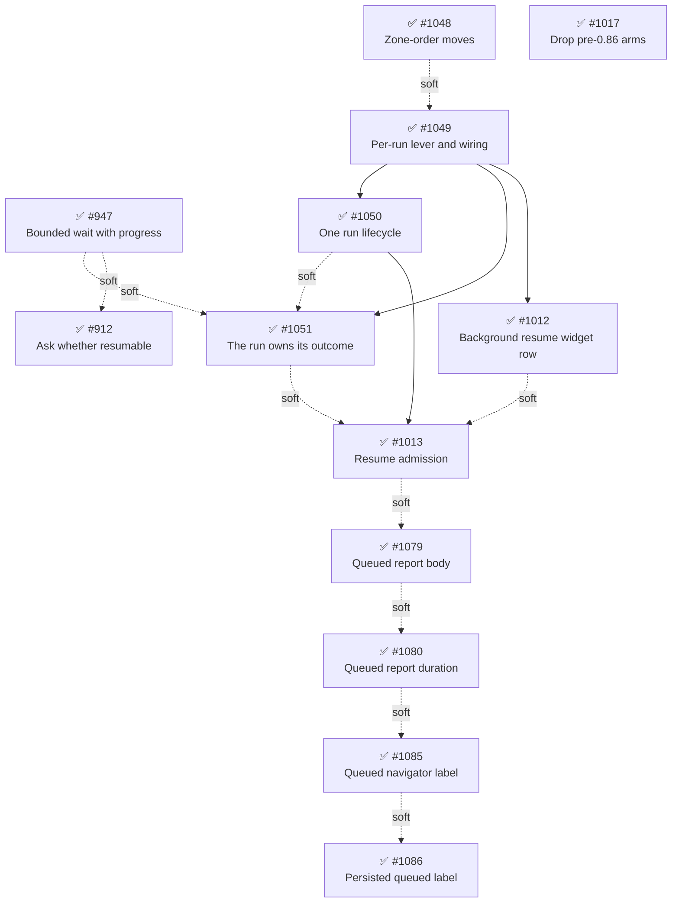

# Phase 23: Runs as first-class

## Findings (planned 2026-10-09)

Phase 22's Findings declared the next spine: what a consumer may learn about a running child ([#947], [#912], and [#755], since closed).
Discovery put that candidate to the operator beside a cause it found underneath the package's hottest file, and the operator took both: the run as the phase's cause, the declared candidate as a parallel track.

The cause is that **a run is not a first-class concept**.
A subagent is a sequence of runs (the initial run, then one per resume), but everything that belongs to one run lives as a field on the per-agent record: the abort controller, the signal wiring, the session subscription, the turn budget, the update ledger, the outcome with its claims and consumption, the mode, and the admission.
`resetForResume` clears eight fields by hand to start the next run, a one-slot `_superseded` buffer stands in for the run a waiter waited on, and "initial or resume" is re-decided in parallel method pairs at three layers: `runTurnLoop`/`resumeTurnLoop`, `run`/`runResume`, `completeRun`/`completeResume`, `failRun`/`failResume`, `onStarted`/`onResumeStarted`, and `onRunFinished`/`onResumeFinished`.
It traces to the first-principles section's "`Subagent` is four conflated domains": those four describe one run, and the refinement the steps realize is recorded there as "A subagent is a sequence of runs".

The evidence, each item measured or read during planning:

- The pairs have diverged.
  `completeRun` tears down the workspace of a run that wrapped up at its turn limit while asking a question; `completeResume` holds it, and no test covers the resume side.
  The craftsmanship scout found the same divergence independently.
- Three open issues are the cause seen from outside: [#1012] (an agent spawned in the foreground and resumed in the background has no widget row, because `isBackground` is fixed at spawn), [#1013] (a background resume bypasses `maxConcurrent`, and the issue names the missing "queued-for-resume state"), and [#949] (a signal that has already fired never cancels its run).
  [#949] is the last open member of Phase 22's bug family of a lever set at one lifecycle edge and read at another.
- Method-level fixes were considered twice and correctly declined.
  [#913]'s assessor rejected a shared `beginRun` helper because the two sequences do not line up, and [#857]'s left the `holdForResume` predicate inline "unless a third site appears"; the two sites diverged first.
  The fix is a lifecycle object, not an extracted method.

Fallow corroborates as symptoms (2026-10-09): health 78 (B), unchanged, with 0 dead code and 0 refactoring targets.
Two vital signs moved since the Phase 22 snapshot, both on the cause.
Production duplication went from 0 to 13 lines in one clone group (`runTurnLoop`/`resumeTurnLoop`), and the hotspot count from 0 to 1: `lifecycle/subagent.ts` (833 lines) rose from 39.9 to 52.1 and overtook `index.ts`, with 12 of its 64 commits landing after the Phase 22 archive.
Real coverage (Istanbul) puts every `src/` file under CRAP 30 except `tools/agent-tool.ts` (42.0), which is unchanged since Phase 20 and not this phase's cause.
The repeated-discriminator sweep found no new family: `this._status !== "stopped"` sits inside its owning object, `raw !== "object"` is a validation edge, `mode === "fullscreen"` is per-consumer presentation, and the `.type === "text"` and `role === "assistant"` sites parse different SDK shapes.
Fallow cannot see the run-kind fork itself, which is spelled as method names rather than comparisons; the 16-name count below is its detector.

The craftsmanship scout refuted all five fallow large-function flags on test files: `subagent-manager.test.ts:158`, `prompts.test.ts:48` and `:387`, `settings.test.ts:352`, and `notification.test.ts:234` are each a nested tree of behavior-named tests, the longest `it` about 67 lines.
It found one concentrated cluster, in the hot file: `test/lifecycle/subagent.test.ts` against `src/lifecycle/subagent.ts`'s run/resume pair.
The cluster holds the divergence above, the missing resume-side test, 19 `mock.calls[N]` reads (12 of them the factory's `askParent`/`notifyParent` channels), duplicated `runWithWorkspace`/`runAsking` arranges, 36 flat top-level `describe` blocks, and four terminal methods public only for tests.
That cluster rides [#1050]; everything else the scout found is scattered and stays on the boy-scout path (listed below).

Directory check: skipped, since `src/` holds 7 root files and every module this phase touches has a home.
The per-run object lands in `src/lifecycle/subagent-run.ts`, and [#1048] moves the two modules that cross the zone order backwards.

Feasibility: [#1017]'s precondition is met.
The peer floor is `>=1.0.0` for all three Pi packages, and Pi 1.0.0's `buildSystemPromptSections` (the installed `dist/core/system-prompt.js`) renders only the section shape, so no `Current working directory:` footer reaches a child.
No other step depends on an SDK surface.

Trajectory: the maximum step priority ran 15 (Phase 20), 16 (Phase 21), 16 (Phase 22), and 16 here ([#947]), and the top hotspot is heating rather than cooling, so the trajectory check does not fire and the regular rotation continues.
Phase 22 recorded no ⚠️ metric misses, so none carries forward.

Composition (operator, 2026-10-09): Track A (runs as first-class), Track A+ ([#1013]), Track B ([#947], with [#912] scheduled into it), and Track D ([#1017]).
Track C, [#1025]'s event-channel consolidation, was offered and declined.
That came to ten steps, so [#949] folds into [#1049]: the run object is born with its lever, and a run whose signal already fired is born aborted.

The operator then asked whether the phase pays down enough debt.
Measured against the earlier sweeps, the scattered items are growing rather than shrinking: `(manager as any).sweep()` reached 8 sites (Phase 22 recorded 7) and the events-observer payload triad 5 (4 when [#858] landed).
A change-scoped Tidy-First assessment declines debt on lines its change does not touch, so the boy-scout path never reaches them.
Each scattered item that sits in a file a step already edits is therefore named on that step as a ride-along, with its own metric row, and the remainder is named as the leading candidate for Phase 24 rather than deferred again (operator decision, 2026-10-09).

| Metric                                                                                   | Baseline (2026-10-09) | Phase 23 target   | Delivered | Recompute                                                                                                     |
| ---------------------------------------------------------------------------------------- | --------------------- | ----------------- | --------- | ------------------------------------------------------------------------------------------------------------- |
| Health score                                                                             | 78 (B)                | ≥ 78 (B)          | 78 (B)    | `pnpm fallow health --score --hotspots --targets --workspace @gotgenes/pi-subagents`                          |
| `lifecycle/subagent.ts` lines                                                            | 833                   | ≤ 700 (estimated) | 864 ⚠️    | `wc -l packages/pi-subagents/src/lifecycle/subagent.ts`                                                       |
| Run-kind-forked lifecycle names in `src/`                                                | 16                    | 0                 | 0         | fenced block below                                                                                            |
| `resetForResume` occurrences in `src/`                                                   | 8                     | 0                 | 0         | fenced block below                                                                                            |
| `_superseded` in `subagent-state.ts`                                                     | 3                     | 0                 | 0         | `grep -c '_superseded' packages/pi-subagents/src/lifecycle/subagent-state.ts`                                 |
| `_abortController` in `subagent.ts`                                                      | 5                     | 0                 | 0         | `grep -c '_abortController' packages/pi-subagents/src/lifecycle/subagent.ts`                                  |
| `lifecycle/` files importing `observation/`                                              | 1                     | 0                 | 0         | `grep -rlE '#src/observation/' packages/pi-subagents/src/lifecycle`                                           |
| `observation/` files importing `ui/`                                                     | 1                     | 0                 | 0         | `grep -rlE '#src/ui/' packages/pi-subagents/src/observation`                                                  |
| Production duplication                                                                   | 13 lines (1 group)    | 0                 | 0         | `pnpm fallow dupes --workspace @gotgenes/pi-subagents`                                                        |
| `mock.calls[N]` reads in `test/lifecycle/subagent.test.ts`                               | 19                    | ≤ 7 (estimated)   | 1         | `grep -c 'mock\.calls\[' packages/pi-subagents/test/lifecycle/subagent.test.ts`                               |
| Pre-0.86 renderer mentions in `session/prompts.ts`                                       | 7                     | 0                 | 0         | `grep -c '0\.85' packages/pi-subagents/src/session/prompts.ts`                                                |
| `result.content[0]` reads in `test/tools/`                                               | 102                   | 0                 | 0         | fenced block below                                                                                            |
| `as any` in `test/lifecycle/subagent-manager.test.ts`                                    | 8                     | 0                 | 0         | `grep -c 'as any' packages/pi-subagents/test/lifecycle/subagent-manager.test.ts`                              |
| Hand-written `description: record.description` payloads in `subagent-events-observer.ts` | 5                     | at most 1         | 1         | `grep -c 'description: record.description' packages/pi-subagents/src/observation/subagent-events-observer.ts` |
| Test files defining a local `AgentConfig` factory                                        | 4                     | 0                 | 0         | `grep -rlE '^function \w+\(overrides: Partial<AgentConfig>' packages/pi-subagents/test`                       |
| Dead code                                                                                | 0                     | 0                 | 0         | `pnpm fallow dead-code --workspace @gotgenes/pi-subagents`                                                    |

The three counts that need a pipeline live here rather than in the table:

```bash
# Run-kind-forked lifecycle names (baseline 16)
grep -rhoE 'runResume|completeResume|failResume|resumeTurnLoop|onResumeStarted|onResumeFinished' packages/pi-subagents/src | wc -l
# resetForResume occurrences (baseline 8)
grep -rhoE 'resetForResume' packages/pi-subagents/src | wc -l
# result.content[0] reads in the tool tests (baseline 102)
grep -rho 'result\.content\[0\]' packages/pi-subagents/test/tools | wc -l
```

The three `grep -rlE` rows count the files they print, so 0 is no output; the shared `AgentConfig` factory is `export`ed from `test/helpers/`, which the anchored pattern does not match.
The `_superseded` row reads 0 if [#1051] dissolves `subagent-state.ts`, since the file is then gone.
The run-kind row counts six names the phase removes; if [#1050] keeps one of them for a reason, it updates the row with that reason in the same commit.
The `mock.calls` target assumes [#1050]'s channel-capturing helper removes the 12 channel reads and leaves the other 7 as they are.
[#947], [#1012], [#1013], and [#912] have design-dependent shapes and are verified by their plans' pinned tests rather than a grep row.
End-of-planning `src/` totals: 12,420 LOC across 73 files, 2,065 tests across 85 files.

Delivered at archive time (recomputed 2026-10-28 with each row's own command, the health score against the `--hotspots --targets` form the baseline used): every targeted row met its target except one.
The miss (⚠️) is `lifecycle/subagent.ts`, which ended at 864 lines against an estimated ≤ 700: the run/resume pairs collapsed and the outcome moved onto `SubagentRun`, and the file read 827 lines after [#1051]; [#1013]'s admission seam (a resume's birth split from its start, a scheduler, and the `resume-queued` refusal) then added 37 lines, past the 833-line baseline.
End-of-phase `src/` totals: 12,661 LOC across 74 files, 2,189 tests across 89 files.

### Open-issue sweep dispositions

- [#947] — adopted as a step (2nd consecutive sweep, scheduled).
  It is Phase 22's declared candidate and this phase's highest priority: a `wait: true` blocked its parent for 74 minutes on a child stuck inside one tool call.
- [#912] — scheduled into Track B by operator decision (2nd consecutive sweep).
  It asks the same question as [#947] from the service side, and the two settle decision 0005's reach together.
- [#949] — folded into [#1049] (2nd consecutive sweep, scheduled).
  The run object owns the signal wiring [#949] fixes, and folding it in keeps the phase at the nine-step ceiling.
- [#1012], [#1013] — adopted as steps (1st sweep).
  Both were filed by [#987]'s planning, and both are the run cause seen from the widget and from the concurrency gate.
- [#1017] — adopted as a step (1st sweep); its precondition landed with [#1006].
- [#1048], [#1049], [#1050], [#1051] — filed by this planning session as the Track A steps.
- [#1025] — deferred by operator decision (1st sweep; offered as Track C and declined).
  It is a breaking change to a contract other packages subscribe to (pi-permission-system and Paseo read `subagents:child:*`), with its design open; [#1050] keeps the published channels unchanged by deciding the run kind once at the events observer, which is the internal half of what it asks.
- [#1023] — deferred (1st sweep): a spike on withdrawing tools for a child's final permitted turn, independent of this phase's cause and suitable for pickup outside the phase.
- [#1047] — out of scope for the roadmap (1st sweep): a one-line default-model change in `default-agents.ts` plus a docs table, suitable for pickup outside the phase.
  [#1045] and [#1046], filed the same day, are its closed duplicates and carry no separate work (recorded at Phase 23 close).
- [#982], [#831] — deferred (1st sweep): consumer affordances for spawning on behalf of a child session, with [#831] being [#982]'s first item (the agent id on `child:session-created`).
  They are feature asks with a named third-party consumer rather than this phase's cause; [#982]'s claim-on-spawn item overlaps [#897].
- [#833] — deferred with rationale (2nd consecutive sweep): `SubagentsService.steer()` emits no `subagents:steered`, a small service-door parity fix suitable for pickup outside the phase.
- [#711], [#695], [#676], [#641], [#835], [#897], [#791], [#683], [#779], [#901] — deferred with rationale (2nd consecutive sweep, operator-accepted).
  They are feature and UX requests, a documentation-only ADR ask, and a glyph audit, none of which gates the run spine; [#791] and [#683] are boy-scout-sized pickups.
  [#901] narrowed when [#1009] stopped children inheriting the parent's tool list, so what remains is a child-stated list.
  [#779]'s foreground-default record no longer gates PRs [#613] and [#740], whose closes triage has approved.
- [#608], [#519] — closed as not planned (3rd consecutive sweep, operator decision).
  [#608] asked for a global `AsyncLocalStorage` store with no verified consumer, which the no-vacant-hooks rule declines, and its open question went unanswered; [#519] narrowed to Pi's own `mode`/`hasUI` contract for SDK embedders, which is upstream's to settle, with no pi-subagents work in it.
- [#722], [#735], [#564] — `pkg:pi-subagents` label dropped (2nd consecutive sweep, operator decision).
  [#722] and [#735] are pi-permission-system-primary and [#564] is pi-github-tools-primary; the label was contextual and pulled no work.
- [#660] — close approved by the 2026-09-15 triage and not yet executed; execution belongs to triage (2nd consecutive sweep).
- PRs [#613], [#740] — closes approved by the 2026-09-15 triage and not yet executed; owned by triage.
  PR [#615] (parent-result redaction) awaits a response, also triage's; redaction for SDK-spawned children is listed as unstated rather than settled under "Scope and non-goals", and it is not this phase's cause.
- Scout inventory (scattered) — the items in files a step already edits ride that step (operator decision, 2026-10-09).
  `result.content[0].text` in the tool tests (102 sites across 5 files) rides [#947]; the events-observer `{id, type, description}` payload triad (5 sites) and the `subagent-session.test.ts` items (an assistant-message literal repeated 10+ times and a third local session mock) ride [#1050]; `(manager as any).sweep()` (8 sites) rides [#1051]; and `prompts.test.ts`'s duplicated append-mode test, with the local `AgentConfig` factories in four test files, rides [#1017].
  The rest is named as the leading candidate for Phase 24, a craftsmanship lean phase if it still stands at that discovery, rather than re-deferred to a boy-scout path that has not reduced it: `settings.ts` `sanitize()` range-check triplication, `index.ts`'s untested inline `createSession` lambda, `sendMessage.mock.calls[0][0]` in `notification.test.ts` (6 sites), the `createManager()` observer defaults, and the five `src/` functions over 60 lines (`index.ts`'s default export, `createSubagentSession`, `toToolDefinition`, `runForeground`, and `resolveSpawnConfig`).
- [#1079] — filed by [#1013]'s planning; becomes a new step after [#1013] (operator decision).
  A queued agent's `get_subagent_result` body falls through to `No output.`; queued spawns already reach it, and [#1013] makes a background resume reach it too.
- [#1080] — filed by [#1079]'s planning; becomes a new step after [#1079] (operator decision).
  The same report's `Duration` stat reads a queued run's time since spawn as `(running)`; [#1079] fixes the body and the bounded-wait note and leaves the stat to this step.
- [#1085] — filed by [#1080]'s planning; becomes a new step after [#1080] (operator decision).
  The `/subagents:sessions` navigator label reads a queued resume's time in the queue as `(running)` through the shared `formatDuration`, which [#1080] leaves alone by fixing the report at its call site.
- [#1086] — filed by [#1085]'s planning; becomes a new step after [#1085] (operator decision).
  After a `/reload`, a resume stopped while queued is labeled from its `subagents:record` entry, which does not record `stoppedWhileQueued`, so the persisted row still reads its queue time as the run's duration; [#1085] fixes the in-memory entries and leaves this row.
- [#1058] — deferred as the leading Phase 24 candidate (recorded at Phase 23 close, operator decision).
  Withheld notifications hold the mutable `Subagent` rather than the run an update belongs to, so a parked message can cross a resume boundary; it is this phase's cause seen from `NotificationManager`, and the run now owns the ledger a fix would key on.
- [#1075], [#1088] — deferred with rationale (recorded at Phase 23 close, operator decision).
  [#1075] is a discussion question about pi-durable with no scoped change, and [#1088] is a session-navigator rendering defect (every tool call painted expanded); neither touches the run spine.

### Deferred tidyings swept

- [#913]'s shared `beginRun(signal)` helper — dissolved by [#1049]: the run object owns the sequence the helper could not line up.
- [#857]'s shared `holdForResume` predicate — dissolved by [#1050]: the two sites diverged, and one terminal path replaces both.
- [#1015]'s `waitUntilSettled` fixture helper — rides [#1051], which rewrites those tests.
- [#889]'s assistant-message factory in `subagent-session.test.ts` — rides [#1050].
- [#755]'s `buildReport`/`buildGetResultDetails` mapping overlap — rides [#947] if its progress fields widen both; otherwise it stays, since the assessor judged the divergence deliberate.
- [#801]'s `AgentConfig` literals — ride [#1017] with the shared factory; [#1009]'s `prompts.test.ts` split stays deferred, since [#1017] already removes that file's pre-0.86 fixtures.
- [#858]'s `(manager as any).sweep()` reaches and payload triad — ride [#1051] and [#1050]; [#798]'s `result.content[0].text` helper rides [#947].
- [#812]'s `index.ts` inline lambdas and [#903]'s `liveRecord()` factory — join the Phase 24 candidate.

## Steps

### ✅ [#947] `get_subagent_result` waits with a bound and reports a running child's progress

**Cause:** the discrete query a parent uses to watch a child cannot report that child's progress.
[Decision 0005](../../decisions/0005-subagent-record-admission-policy.md) keeps momentary activity (`activeTools`, `responseText`) off `SubagentRecord`, and the `get_subagent_result` report inherited that exclusion without a decision of its own, though the widget already renders the same facts to the human.
A `wait: true` is also unbounded, so a child stuck inside one tool call blocked its parent for 74 minutes behind a report indistinguishable from a healthy long run.

- **Smell:** Category C (a boundary drawn for one surface, the public snapshot, applied silently to another, the model-facing report).
- **Target:** `src/tools/get-result-tool.ts` (the wait, and the `_onUpdate` it discards), `src/tools/get-result-report.ts`, and the tool's description; decision 0005 gains a sentence on what the report may carry if the plan admits activity facts there.
- **Design questions the step must settle:** the bound's shape (the issue proposes an optional, model-chosen timeout with no default, mirroring `bash`), which progress facts the report carries (activity, turns used, a last-progress time, for which the transcript's mtime is one source), and the description's wording that an expired wait does not stop the child.
- **Ride-along tidying:** a `test:` commit ahead of the change extracts a `textOf(result)` helper into `test/helpers/` and migrates the 102 `result.content[0]` reads across the five tool test files, 24 of them in `get-result-tool.test.ts`, which this step rewrites anyway.
  The `result.content[0]` row reads 0.
- **Outcome:** a bounded wait returns at its bound with the child still running and the progress facts in the report, and an unbounded wait behaves as it does today; pinned by the plan's tests.
- **Commit type:** to be decided at plan time (an added optional parameter reads as `feat:`, the unbounded wait as `fix:`); `test:` for the ride-along.
- **Impact 4 / Risk 2 / Priority 16.**

Landed: `get_subagent_result` takes an optional `timeout` in seconds with no default; a bounded wait swaps only the signal `waitUntilSettled` ends on, so an expired wait releases its claim and leaves the agent running, and the report, description, and parameter text say so.
Every report on a running agent carries a `Progress:` line (activity, turns used, time since the last session event, stamped by `record-observer` on `SubagentState.lastProgressAt`), and decision 0005 records that the report, not the snapshot, admits those facts.
The `textOf` ride-along landed first; the `result.content[0]` row reads 0, and `GetResultDetails` stayed unchanged, so [#755]'s mapping overlap stays.

Release: independent

### ✅ [#1048] Move `record-observer` into `lifecycle/` and the notification renderer into `ui/`

**Cause:** the zone order is unstated, and two modules were filed by what they touch rather than by who owns them.
`record-observer.ts` is the run's own metric accumulator, with one caller and one target, both in `lifecycle/`; `observation/renderer.ts` is presentation that only the composition root imports.
Each is the sole reason for an edge that runs against `lifecycle/`, then `observation/`, then `ui/`.

- **Smell:** Category C (cross-layer import) and Category E (unclear module boundary).
- **Target:** `src/observation/record-observer.ts` to `src/lifecycle/record-observer.ts`; `src/observation/renderer.ts` to `src/ui/notification-renderer.ts`; their tests; `.fallowrc.json`, where `pi-subagents/lifecycle` drops `pi-subagents/observation` and `pi-subagents/observation` drops `pi-subagents/ui`; and the "Module organization" paragraph.
- **Outcome:** both zone-import rows read 0, and fallow reports no boundary violation against the narrowed allow lists.
- **Commit type:** `refactor:`.
- **Impact 2 / Risk 1 / Priority 10.**

Landed: `record-observer.ts` lives in `lifecycle/` and the three message renderers in `ui/notification-renderer.ts`, and both zone-import rows read 0.
The move gave `ui/` a forward edge to `observation/` for the `*Details` message contracts the renderers read, which the `ui` zone admits through `allowTypeOnly`; `fallow dead-code` reports no boundary violation, and a value import across that edge, or either backwards edge, is still reported.

Release: independent

### ✅ [#1049] Give each run its own abort lever, signal wiring, and session subscription (with [#949])

**Cause:** the handles a run wires at its start and releases at its end live on the per-agent record, so each run and resume re-mints them by hand (`_abortController` in the constructor, `run()`, and `runResume()`, and one shared `RunListeners`).
A lever set at one lifecycle edge can then be read at another: Phase 22's [#913], and [#949], where a signal that already fired is wired to a listener that can never fire.

- **Smell:** Category C (mutable per-run state on a longer-lived object; a lifecycle object, not an extracted method).
- **Target:** a new `src/lifecycle/subagent-run.ts`; `src/lifecycle/subagent.ts` (`_abortController`, `listeners`, `run()`, `runResume()`, `abort()`); `src/lifecycle/run-listeners.ts`, which it absorbs; and `forwardAbortSignal` in `src/lifecycle/subagent-session.ts`, [#949]'s second site.
- **Soft dependency:** [#1048] — the run subscribes the record observer, which [#1048] moves to its final home first.
- **Design question the step must settle:** where a run born with an already-fired signal stops (before workspace preparation, before session creation, or at the turn loop) and what it reports, which is the behavior change [#949] left out of [#913]'s scope.
- **Outcome:** `_abortController` reads 0 in `subagent.ts`, `run-listeners.ts` is gone, and a run or resume handed an already-fired signal ends without spending a turn (pinned).
  The outcome stays on `SubagentState`; [#1051] moves it.
- **Commit type:** `refactor:` for the extraction, `fix:` for [#949].
- **Impact 4 / Risk 3 / Priority 12.**

Landed: `SubagentRun` (`src/lifecycle/subagent-run.ts`) owns one run's abort controller, caller-signal wiring, and record-observer unsubscribe, and `Subagent` keeps the current run; `_abortController` reads 0 and `run-listeners.ts` is gone.
A caller signal that already fired gives a run born aborted: a spawn stops right after `onStarted`, before the workspace or child session exists, and a resume reaches its turn loop with a fired lever.
Either loop handed a fired signal takes no turn and returns no text, and the initial loop still emits `subagents:child:completed`; that also stops a child whose `abort(id)` lands during setup.
The guard lives in one prompt helper both loops share, which removed the `runTurnLoop`/`resumeTurnLoop` production clone group ahead of [#1050].
`lifecycle/subagent.ts` grew from 834 to 850 lines; the run-kind and `resetForResume` rows are unchanged at 16 and 8.

Release: independent

### ✅ [#1050] Run initial and resumed runs through one lifecycle

**Cause:** whether a run is the initial run or a resume is a property of the run, but it is re-decided in parallel method pairs at three layers (the session's turn loop, the record's run body and terminal transitions, and the lifecycle observer), and the pairs have already diverged.
A resumed run that wraps up at its turn limit while asking a question keeps its workspace, where an initial run in the same state tears it down: [#1021]'s rule, which [#1022] did not carry to resumes when it gave them a turn budget.
`fallow dupes` saw the session layer's half as the package's only production clone group until [#1049] gave both turn loops one prompt helper; the session layer's method pair remains.

- **Smell:** Category C (a repeated discriminator spelled as method pairs), Category A (production duplication), and Category G (the concentrated test-design cluster in `test/lifecycle/subagent.test.ts`).
- **Target:** `src/lifecycle/subagent-session.ts` (`runTurnLoop`/`resumeTurnLoop`); `src/lifecycle/subagent.ts` (`run`/`runResume`, `completeRun`/`completeResume`, `failRun`/`failResume`); `SubagentLifecycleObserver` and `SubagentManager.buildObserver`; `src/observation/subagent-events-observer.ts`, which maps the run kind to the published channels in one place; and `test/lifecycle/subagent.test.ts` and `test/lifecycle/subagent-session.test.ts`.
- **Hard dependency:** [#1049] — the run object carries the kind the single path reads.
- **Constraint:** the published `subagents:*` channels and their payloads do not change.
  Whether `SubagentManagerObserver`'s `onSubagentResuming`/`onSubagentResumed` collapse too is the plan's call.
- **Ride-along tidying:** one builder for the `{ id, type, description }` payload the events observer writes by hand at 5 sites, since this step rewrites how that observer maps runs to channels; and in `subagent-session.test.ts`, an assistant-message factory for the literal repeated 10+ times, with the third local session mock folded into the shared ones.
  The payload row reads at most 1.
- **Outcome:** the run-kind-forked names row reads 0 and `fallow dupes` still reports no production clone (met since [#1049]).
  A resumed run follows the initial run's workspace rule, pinned by the missing resume-side test, written first.
  The four terminal methods are private, the `subagent.test.ts` `mock.calls[N]` reads fall to the row's target through a channel-capturing helper, and the `describe` blocks nest by run kind.
- **Commit type:** `fix:` for the resume's workspace rule; `refactor:` and `test:` for the rest, including the ride-along.
- **Impact 5 / Risk 3 / Priority 15.**

Landed: both run kinds hold the workspace of a completed run that declared a question, including one that wrapped up at its turn limit.
The operator chose hold over the initial run's teardown rule, which only [#1021]'s plan had recorded; the user-facing docs already described hold, so the `fix:` changed the initial run and the resume side is pinned as it was.
`SubagentRun` carries its kind, `Subagent` runs both kinds through one body with private `complete`/`fail`, and the session owns its first run: its turn limits are resolved at creation, and only the first run carries the parent context and emits `subagents:child:completed`.
The lifecycle observer reports `onRunStarted`/`onRunFinished` and the manager observer `onSubagentRunStarted`/`onSubagentRunFinished`, each with the kind, and `SubagentEventsObserver` maps it to the unchanged published channels in one place.
The run-kind row reads 0, the payload row 1, the `subagent.test.ts` `mock.calls[N]` row 1 (the `prepare` read its comment explains), and that file nests under one root `describe` with a run-kind grid for the terminal rules; `lifecycle/subagent.ts` fell from 850 to 826 lines.

Release: independent

### ✅ [#1012] A background resume shows a widget row

**Cause:** mode (foreground or background) is a fact about a run, but the record fixes it at spawn as `isBackground`, so an agent spawned in the foreground and resumed in the background runs with no widget row: the widget lists the records whose spawn-time mode was background.

- **Smell:** Category C (a per-run fact stored per agent).
- **Target:** `src/ui/agent-widget.ts` (`listBackgroundAgents`), the per-run object from [#1049], and `SubagentManager.startResume`.
- **Hard dependency:** [#1049] — the run is what carries the mode.
- **Design question the step must settle:** whether `SubagentRecord.isBackground` keeps its spawn-time meaning or reports the current run's mode, under decision 0005 (the snapshot is by value, and giving a field a new meaning needs the same care as retyping it).
- **Outcome:** a record running a background resume shows in the widget regardless of the mode it was spawned in (pinned).
- **Commit type:** `fix!:` (the public `SubagentRecord.isBackground` changed meaning).
- **Impact 3 / Risk 2 / Priority 12.**

Landed: `SubagentRun` carries its mode (`inBackground`), and `Subagent.isBackground`, with the public `SubagentRecord.isBackground` copied from it, reports the current run's mode: the spawn's before the first run, then each run's own.
`SubagentRecord.isBackground` therefore keeps no spawn-time meaning, a breaking change decision 0005 now records.
Every front door states a resume's mode through the required `ResumeCallOptions.background`: the tool's `run_in_background: true` resume and `SubagentsService.resume()` run in the background, and the tool's foreground resume streams inline progress through the `startProgressStream` it now shares with a foreground spawn.
The widget also resets a record's linger age when a run starts, so a resumed run's finished row lingers like the first run's.

Release: independent

### ✅ [#1051] Let each run own its outcome, so a waiter holds the run it waited on

**Cause:** the run's outcome lives on the per-agent `SubagentState`, which simulates a sequence of runs by hand.
`resetForResume` clears eight fields to start the next run, a one-slot `_superseded` buffer stands in for the run a waiter waited on, and claims are special-cased to survive the reset, the seam [#1015] fixed a bug in.
`get_subagent_result` carries matching workarounds: a `superseded` outcome threaded through the report, and `withoutQuestion`.

- **Smell:** Category C (scattered resets; state owned by the wrong object).
- **Target:** `src/lifecycle/subagent-state.ts`, `src/lifecycle/subagent-run.ts`, `src/lifecycle/subagent.ts` (`waitUntilSettled` and the read-through getters), `src/lifecycle/subagent-manager.ts` (`startResume`'s claim), and `src/tools/get-result-tool.ts`.
- **Hard dependency:** [#1049] — the run object the outcome moves onto.
- **Soft dependency:** [#1050], [#947] — after [#1050] the outcome moves through one path instead of two, and [#947] rewrites the same `get_subagent_result` wait this step changes.
- **Constraint:** `SubagentRecord` is unchanged (including the `resumeRefusal` field [#912] added, which keeps reading `Subagent.resumeRefusal`), and the delivery semantics Phase 22 settled (claims, consumption, exactly-once updates) are preserved rather than re-decided; the service tests pass unmodified.
- **Ride-along tidying:** a public or fake-timer-driven way to run the retention sweep, replacing the 8 `as any` reaches in `subagent-manager.test.ts`; this step changes what the sweep reads (consumption moves onto the run), so those tests are rewritten anyway.
  The `as any` row reads 0.
- **Outcome:** the `resetForResume` and `_superseded` rows read 0, and a waiter reports the outcome of the run it waited on without a superseded slot.
- **Commit type:** `refactor:`; `test:` for the ride-along.
- **Impact 4 / Risk 3 / Priority 12.**

Landed: `SubagentRun` owns one run's outcome (status, result, error, timestamps, the never-started marker, question, workspace notice, turn budget, update ledger, claims, and consumption) and its transitions, and `Subagent` reads each through its current run; `SubagentState` keeps the lifetime metrics and live activity.
A run is born queued with its agent or its resume and wires the caller's signal when it starts, so a queued agent is claimed on the run it is waiting to start, and a resume's caller passes `claimOutcome` so the new run is born claimed.
`waitUntilSettled` returns the run the wait began on, a resume marks the run it replaces, and a replaced run reports no open question, so `get_subagent_result` reports that run directly; `liveOutcome`, `withoutQuestion`, and the superseded slot are gone, and a wait two resumes overtook now reports its own run instead of the live record.
A terminal transition lands on the run it ends, so an aborted run whose turn loop returns after a resume started no longer overwrites the resume (`fix:`, reachable through `SubagentsService.abort` then `resume`).
The sweep tests drive the real interval through fake timers; the `_superseded`, `resetForResume`, and `as any` rows read 0, `lifecycle/subagent.ts` fell from 846 to 827 lines, `fallow dupes --workspace @gotgenes/pi-subagents` reports no clone group (the `subagent-state.ts` fixture pairing dissolved), and health reads 88 (A).

Release: independent

### ✅ [#1013] Admit a background resume through `maxConcurrent`

**Cause:** admission through the concurrency gate is a fact about a run, but only the initial run is scheduled on the limiter.
A resume starts directly, so since [#987] a background resume runs at capacity where a background spawn would queue.

- **Smell:** Category C (a per-run fact decided per agent).
- **Target:** `src/lifecycle/subagent-manager.ts` (`startResume`), `src/lifecycle/concurrency-limiter.ts`, the run object, and `resumeRefusal`, since a run queued for resume must refuse a second resume.
- **Hard dependency:** [#1050] — abort-while-queued must end a queued resume through the one terminal path, not through `stopQueued`'s initial-run notification.
- **Soft dependency:** [#1051], [#1012] — a queued resume is a new run whose status starts `queued`, which [#1051] makes natural, and [#1012] settles where a run's mode lives.
- **Design question the step must settle:** whether a background resume should queue at all; [#987]'s operator chose immediate starts, and this step decides again with the run concept in place.
- **Outcome:** a background resume at capacity queues and starts when a slot frees, or the decision not to queue is recorded with its reason; pinned either way.
- **Commit type:** to be decided at plan time.
- **Impact 3 / Risk 3 / Priority 9.**

Landed: a background resume, from the tool's `run_in_background: true` and from `SubagentsService.resume()`, is admitted through the limiter like a background spawn, and a foreground tool resume starts at once.
`Subagent.resume` takes a `RunScheduler`: the resume's run is born queued (claimed when the caller asks) and starts when admitted, and a run stopped while it waited never starts, which the guard reads on the run rather than the record.
`stopQueued` ends a queued run on its own kind's path, so a stopped queued resume publishes `subagents:resumed` once.
A record whose resume is queued refuses another with the new `resume-queued` member of `ResumeRefusal`, a `fix!:` because the union is published; the tool's launch message says a resume was queued, with its position.
`concurrency-limiter.ts` needed no change.

Release: independent

### ✅ [#1079] A queued agent's report says it has not started

**Cause:** the shared outcome body has no arm for a run still waiting on a concurrency slot.
`renderOutcomeBody` (`src/observation/outcome-delivery.ts`) words `running`, `error`, and a queued run that was stopped, so a queued run falls through to the empty-result fallback and `get_subagent_result` reports `No output.` under `Status: queued`.

- **Smell:** Category C (a status the carrier's body does not distinguish from an empty result).
- **Target:** `src/observation/outcome-delivery.ts` (`renderOutcomeBody`), `src/tools/get-result-report.ts` (`renderWaitExpired`), and their tests.
- **Soft dependency:** [#1013] — a background resume at capacity becomes a second way to reach the queued state.
- **Outcome:** a queued agent's report says it is waiting for a concurrency slot and has not started, and points at `wait: true`; pinned.
- **Commit type:** `fix:`.
- **Impact 2 / Risk 1 / Priority 10.**

Landed: `renderOutcomeBody` words a queued run as not started and waiting for a concurrency slot, pointing at `wait: true`, so `get_subagent_result` no longer reports `No output.` for it; only that pull can see the status, since every other carrier renders a settled run.
A bounded wait that expires on a queued agent now says it is still queued and that waiting again is how to collect it, where the running agent's note (unchanged) says waiting again will not unstick it.
The report's `Duration` stat is [#1080]'s.

Release: independent

### ✅ [#1080] A queued agent's report does not call its wait running time

**Cause:** the report's `Duration` stat does not distinguish a run waiting on a concurrency slot from a running one.
`GetResultTool.buildReport` renders it with `formatDuration(startedAt, completedAt)`, which appends `(running)` whenever `completedAt` is unset, and a run's `startedAt` is its construction time until the limiter admits it.

- **Smell:** Category C (a status a carrier's stat does not distinguish).
- **Target:** `src/tools/get-result-tool.ts` (`buildReport`, `buildGetResultDetails`) and its tests; `formatDuration` in `src/ui/display.ts` is shared, so the call site is the likelier home.
- **Soft dependency:** [#1079] — the same report's body and bounded-wait note learn the queued state first.
- **Outcome:** a queued agent's report, and that of a run stopped while queued, does not label its time in the queue as running time; pinned.
- **Commit type:** `fix:`.
- **Impact 1 / Risk 1 / Priority 5.**

Landed: `get_subagent_result` renders the `Duration` stat of a run the limiter never admitted as its time in the queue, `queued 5.0s`, in the report text and the TUI details alike.
A run still queued reads its time since it was enqueued; a run stopped while queued keeps the time it waited, frozen at the stop.
The decision lives in `formatRunDuration` (`src/tools/get-result-tool.ts`), which both report builders call; the shared `formatDuration` is unchanged, and the session navigator's label, its other caller, is [#1085]'s.

Release: independent

### ✅ [#1085] A queued resume's navigator label does not call its wait running time

**Cause:** the session navigator's label does not distinguish a run waiting on a concurrency slot from a running one.
`buildLabel` (`src/ui/session-navigation.ts`) renders it with `formatDuration(startedAt, completedAt)`, and a queued resume keeps its prior session, so `listNavigableAgents` lists it as a live entry labeled `queued · 3.0s (running)`.

- **Smell:** Category C (a status a carrier's label does not distinguish).
- **Target:** `src/ui/session-navigation.ts` (`buildLabel`) and its tests; possibly the queue-time rendering [#1080] settles for the report.
- **Soft dependency:** [#1080] — the report settles the queue-time wording first.
- **Outcome:** a queued resume's navigator label does not present its time in the queue as running time; pinned.
- **Commit type:** `fix:`.
- **Impact 1 / Risk 1 / Priority 5.**

Landed: the `/subagents:sessions` picker labels a queued resume `queued · queued <seconds>` and a resume stopped while queued `stopped · queued <seconds>`, live or released in memory, in the wording `get_subagent_result` uses.
`formatRunDuration` now lives in `src/ui/display.ts` over a narrow `RunTiming`, shared by both report builders and `buildLabel`, and `formatDuration` is private to it.
A run labeled from its persisted `subagents:record` entry still reads as one that started; that row is [#1086]'s.

Release: independent

### ✅ [#1086] A reloaded resume stopped while queued does not label its wait as its duration

**Cause:** the `subagents:record` entry does not record whether a run was stopped while queued.
`readPersistedRuns` returns a `PersistedRunSummary` without `stoppedWhileQueued`, so `buildLabel` renders a persisted resume stopped while queued as `stopped · 3.0s · session released (snapshot)`.

- **Smell:** Category C (a status a carrier's label does not distinguish).
- **Target:** `src/persisted-record.ts` (`PersistedSubagentRecord`, `PersistedRunSummary`, `toPersistedRecord`, `asRunSummary`), the persisted-runs call site in `src/ui/session-navigation.ts` (`listNavigableAgents`), and their tests.
- **Soft dependency:** [#1085] — the navigator label learns the queue-time rendering first.
- **Outcome:** a persisted resume stopped while queued is labeled with its time in the queue, and an entry written before the field existed reads as not stopped while queued; pinned.
- **Commit type:** `fix:`.
- **Impact 1 / Risk 1 / Priority 5.**

Landed: the `subagents:record` entry records `stoppedWhileQueued`, copied by `toPersistedRecord` and validated by `asRunSummary`, so after a `/reload` the `/subagents:sessions` row of a resume stopped while queued reads `stopped · queued <seconds> · session released (snapshot)`, like its in-memory row.
An entry written before the field existed reads as not stopped while queued and keeps its label, and `listNavigableAgents` passes each persisted run to `buildLabel` unadapted.

Release: independent

### ✅ [#912] Let a consumer ask whether an agent is resumable

**Cause:** the query surface cannot report a decision the core already makes.
`Subagent.resumeRefusal` composes `status`, `sessionReleased`, and `workspaceDisposed`, and `SubagentRecord` carries only the first, so a consumer cannot tell a resumable agent from one the retention sweep released.

- **Smell:** Category C (a core decision its query surface cannot report).
- **Target:** `src/service/service.ts`, `src/service/service-adapter.ts`, and possibly decision 0005.
- **Soft dependency:** [#947] — both decide what a consumer may learn about an agent under decision 0005, and [#947] settles the report half first.
- **Design question the step must settle:** a `resumeRefusal` field on `SubagentRecord`, which needs an admission argument under decision 0005 (it derives from durable facts: a released session and a disposed workspace do not come back), or a `resumeRefusalFor(id)` service query.
- **Outcome:** a consumer holding an agent id can learn whether `resume` would be refused, and why, before calling it.
- **Commit type:** `feat:`.
- **Impact 2 / Risk 2 / Priority 8.**

Landed: `SubagentRecord` gains an optional `resumeRefusal`, copied by `toSubagentRecord` from `Subagent.resumeRefusal` and absent when a resume would start, so `listAgents()` answers per row.
Decision 0005's rule 2 now names lifecycle status, and its dispositions table admits `resumeRefusal` on that basis (with the `pendingQuestion` row it lacked).

Release: independent

### ✅ [#1017] Drop the pre-0.86 prompt-renderer arms

**Cause:** dead compatibility code.
`session/prompts.ts` accepts both of Pi's prompt renderers because the peer range used to admit both, and [#1006] raised the floor to `>=1.0.0`, which renders only the section shape.

- **Smell:** Category A (dead code the peer floor made unreachable).
- **Target:** `src/session/prompts.ts` (the footer anchor and the 0.85 arm in `projectContextStart`), the pre-0.86 notes in `src/session/project-context.ts` and `src/lifecycle/parent-snapshot.ts`, the 0.85 fixtures in `test/session/prompts.test.ts` and `test/session/project-context.test.ts`, and the pre-0.86 sentence in `docs/configuration.md`.
- **Ride-along tidying:** one shared `AgentConfig` factory in `test/helpers/`, replacing the local factories in `agent-types.test.ts`, `invocation-config.test.ts`, `session-config.test.ts`, and `subagent-manager.test.ts` and the repeated literals in `prompts.test.ts`, and the duplicated append-mode generic-base fallback test in `prompts.test.ts`.
  The `AgentConfig` factory row reads 0.
- **Outcome:** the pre-0.86 mentions row reads 0; if the plan finds an arm that still serves a `>=1.0.0` prompt, it updates the row with its reason.
- **Commit type:** `refactor:`, with a `docs:` commit for `docs/configuration.md`; `test:` for the ride-along.
- **Impact 2 / Risk 1 / Priority 10.**

Landed: `session/prompts.ts` anchors the inherited-identity cut on Pi's `<cwd>` section alone; the footer arm, its `"footer"` shape, and the two-lines-below project-context lead-in are gone with their fixtures, so the pre-0.86 mentions row reads 0.
One arm still serves a `>=1.0.0` prompt: a parent prompt with no `<cwd>` section, which a `before_agent_start` handler's returned `systemPrompt` produces.
Planning found it cut inside Pi's `<skills>` wrapper, and the step's release vehicle became a `fix:` that cuts at the wrapper, so such a child carries no stray `<skills>` line and a relocated one drops the parent's `<project_context>`.
The ride-along landed too: `test/helpers/make-agent-config.ts` replaces the four local factories (the factory row reads 0) and the `prompts.test.ts` literals, and the duplicated append-mode fallback test is gone.

Release: independent

## Step dependency diagram



The section order under `### Steps` is the recommended working sequence; the diagram is laid out by dependency instead.
[#947] leads because it is the phase's highest priority and independent of the spine, and it rewrites the `get_subagent_result` wait before [#1051] reshapes what that wait returns.
Every Track A step rewrites `lifecycle/subagent.ts`, so those steps sequence rather than parallelize.

## Parallel tracks

- **Track A — Runs as first-class:** [#1048] → [#1049] → [#1050] → [#1051], with [#1012] branching from [#1049].
  Owns `src/lifecycle/` and `test/lifecycle/`.
- **Track A+ — Resume admission:** [#1013], after [#1050], and preferably after [#1051] and [#1012].
- **Track B — What a consumer may learn about an agent:** [#947] → [#912].
  Owns `src/tools/get-result-*.ts` and `src/service/`; [#947] shares the `get_subagent_result` wait with Track A's [#1051], so it lands first.
- **Track A++ — Queued-state reporting:** [#1079] → [#1080] → [#1085] → [#1086], each filed by the previous step's planning after [#1013] made a queued resume reachable.
  Owns `src/observation/outcome-delivery.ts`, `src/tools/get-result-*.ts`, `src/ui/session-navigation.ts`, and `src/persisted-record.ts`.
- **Track D — Dead prompt-renderer arms:** [#1017], fully independent; owns `src/session/prompts.ts` and its tests.

## Release batches

- Independently releasable: [#947], [#1048], [#1049], [#1050], [#1012], [#1051], [#1013], [#1079], [#1080], [#1085], [#1086], [#912], [#1017].
- Release vehicles: [#947] (`feat:` or `fix:`, decided at plan time), [#1049] (`fix:` for [#949]), [#1050] (`fix:` for the resume's workspace rule), [#1012] (`fix!:`), [#1051] (`fix:` for a stopped run's late result landing on its resume), [#1013] (`fix!:` for the `resume-queued` refusal), [#1079] (`fix:`), [#1080] (`fix:`), [#1085] (`fix:`), [#1086] (`fix:`), [#912] (`feat:`), and [#1017] (`fix:` for a forced parent prompt's skills section, with `docs:` for the configuration note).
  [#1048] is `refactor:` only and cuts no release on its own.
- No batches: every step leaves the package releasable, and the refactoring steps preserve behavior.

[#519]: https://github.com/gotgenes/pi-packages/issues/519
[#564]: https://github.com/gotgenes/pi-packages/issues/564
[#608]: https://github.com/gotgenes/pi-packages/issues/608
[#613]: https://github.com/gotgenes/pi-packages/pull/613
[#615]: https://github.com/gotgenes/pi-packages/pull/615
[#641]: https://github.com/gotgenes/pi-packages/issues/641
[#660]: https://github.com/gotgenes/pi-packages/issues/660
[#676]: https://github.com/gotgenes/pi-packages/issues/676
[#683]: https://github.com/gotgenes/pi-packages/issues/683
[#695]: https://github.com/gotgenes/pi-packages/issues/695
[#711]: https://github.com/gotgenes/pi-packages/issues/711
[#722]: https://github.com/gotgenes/pi-packages/issues/722
[#735]: https://github.com/gotgenes/pi-packages/issues/735
[#740]: https://github.com/gotgenes/pi-packages/pull/740
[#755]: https://github.com/gotgenes/pi-packages/issues/755
[#779]: https://github.com/gotgenes/pi-packages/issues/779
[#791]: https://github.com/gotgenes/pi-packages/issues/791
[#798]: https://github.com/gotgenes/pi-packages/issues/798
[#801]: https://github.com/gotgenes/pi-packages/issues/801
[#812]: https://github.com/gotgenes/pi-packages/issues/812
[#831]: https://github.com/gotgenes/pi-packages/issues/831
[#833]: https://github.com/gotgenes/pi-packages/issues/833
[#835]: https://github.com/gotgenes/pi-packages/issues/835
[#857]: https://github.com/gotgenes/pi-packages/issues/857
[#858]: https://github.com/gotgenes/pi-packages/issues/858
[#889]: https://github.com/gotgenes/pi-packages/issues/889
[#897]: https://github.com/gotgenes/pi-packages/issues/897
[#901]: https://github.com/gotgenes/pi-packages/issues/901
[#903]: https://github.com/gotgenes/pi-packages/issues/903
[#912]: https://github.com/gotgenes/pi-packages/issues/912
[#913]: https://github.com/gotgenes/pi-packages/issues/913
[#947]: https://github.com/gotgenes/pi-packages/issues/947
[#949]: https://github.com/gotgenes/pi-packages/issues/949
[#982]: https://github.com/gotgenes/pi-packages/issues/982
[#987]: https://github.com/gotgenes/pi-packages/issues/987
[#1006]: https://github.com/gotgenes/pi-packages/issues/1006
[#1009]: https://github.com/gotgenes/pi-packages/issues/1009
[#1012]: https://github.com/gotgenes/pi-packages/issues/1012
[#1013]: https://github.com/gotgenes/pi-packages/issues/1013
[#1015]: https://github.com/gotgenes/pi-packages/issues/1015
[#1017]: https://github.com/gotgenes/pi-packages/issues/1017
[#1021]: https://github.com/gotgenes/pi-packages/issues/1021
[#1022]: https://github.com/gotgenes/pi-packages/issues/1022
[#1023]: https://github.com/gotgenes/pi-packages/issues/1023
[#1025]: https://github.com/gotgenes/pi-packages/issues/1025
[#1045]: https://github.com/gotgenes/pi-packages/issues/1045
[#1046]: https://github.com/gotgenes/pi-packages/issues/1046
[#1047]: https://github.com/gotgenes/pi-packages/issues/1047
[#1048]: https://github.com/gotgenes/pi-packages/issues/1048
[#1049]: https://github.com/gotgenes/pi-packages/issues/1049
[#1050]: https://github.com/gotgenes/pi-packages/issues/1050
[#1051]: https://github.com/gotgenes/pi-packages/issues/1051
[#1058]: https://github.com/gotgenes/pi-packages/issues/1058
[#1075]: https://github.com/gotgenes/pi-packages/issues/1075
[#1079]: https://github.com/gotgenes/pi-packages/issues/1079
[#1080]: https://github.com/gotgenes/pi-packages/issues/1080
[#1085]: https://github.com/gotgenes/pi-packages/issues/1085
[#1086]: https://github.com/gotgenes/pi-packages/issues/1086
[#1088]: https://github.com/gotgenes/pi-packages/issues/1088
